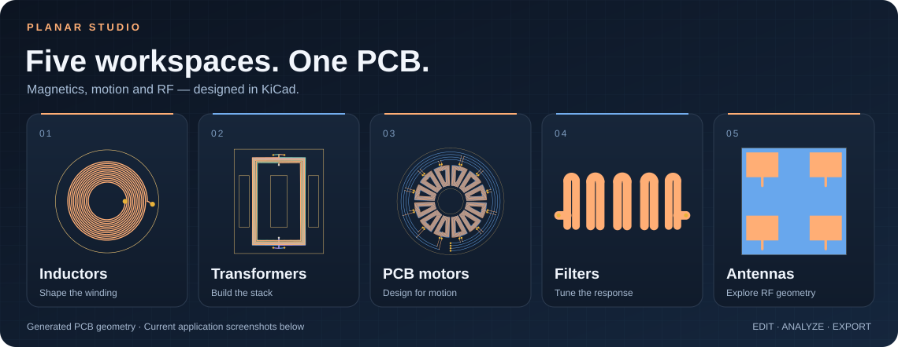
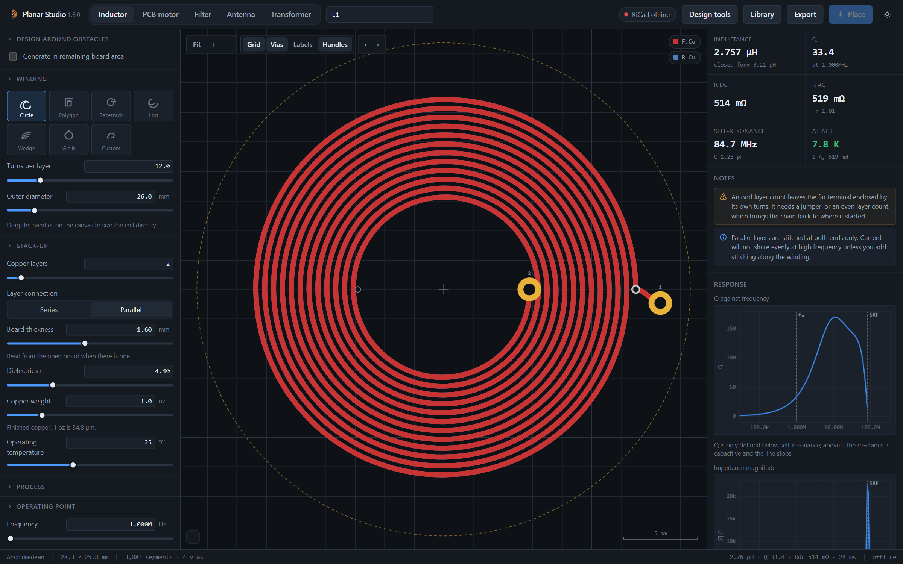
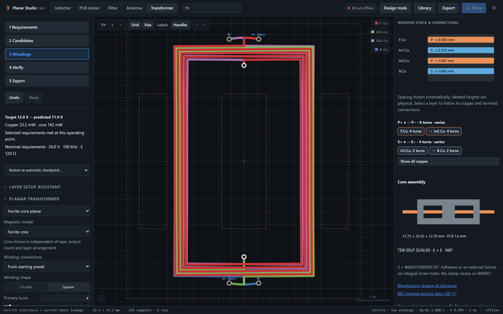
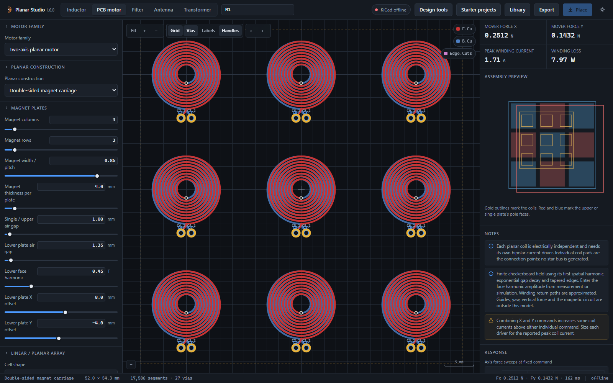
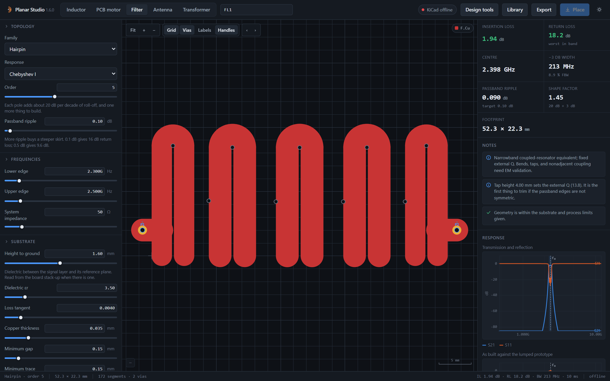
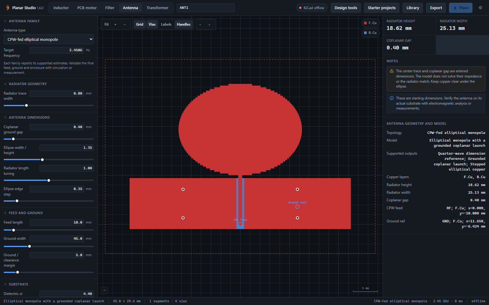
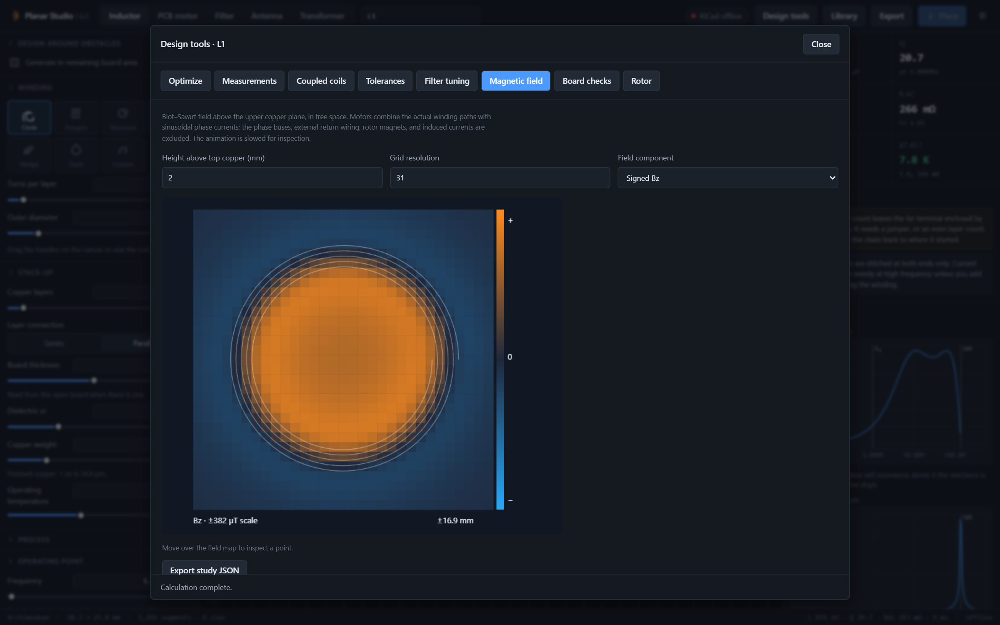
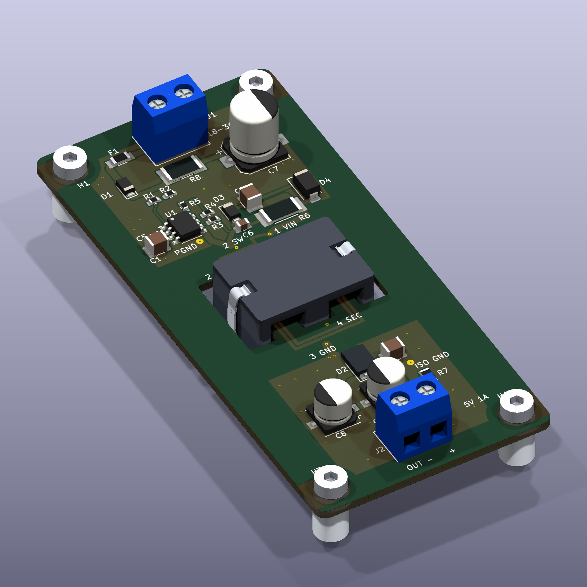
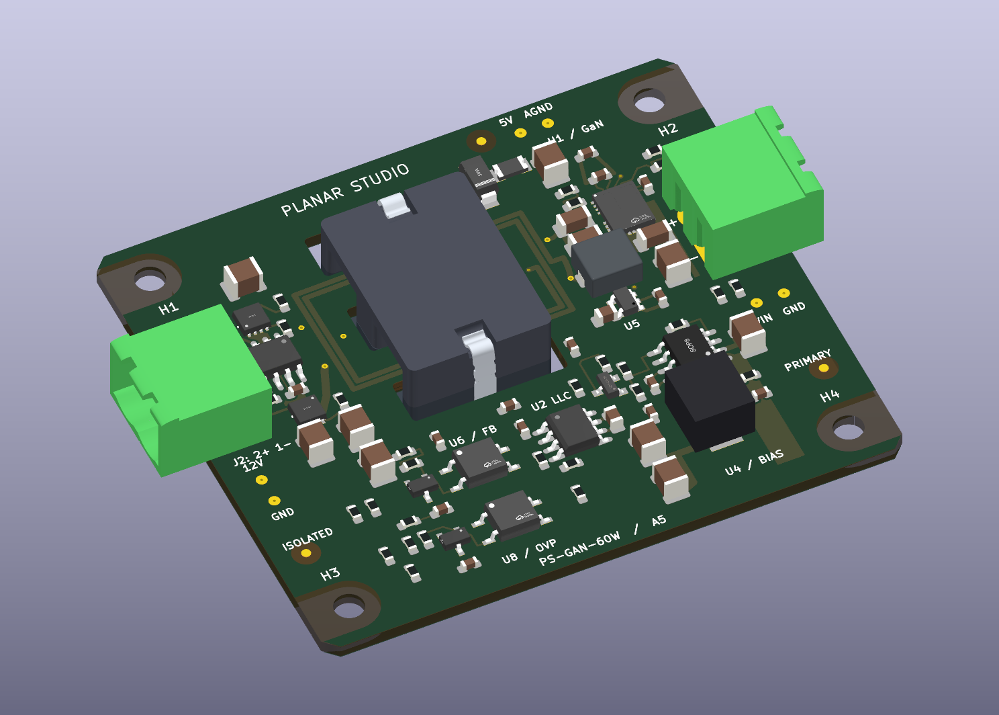
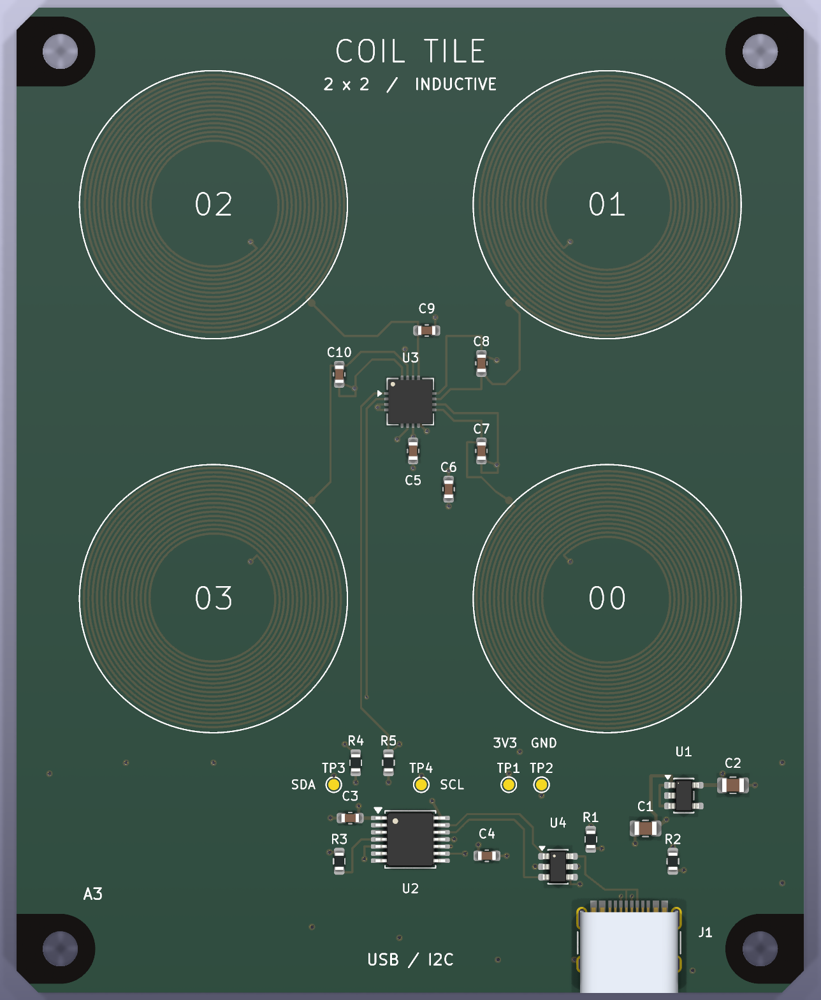

# Planar Studio

Design planar inductors, transformers, PCB motors, filters and antennas inside
KiCad. Planar Studio reads your board's stack, calculates electrical estimates,
and places the generated copper into the PCB as one undoable operation.

**[Download v1.6.0](https://github.com/jonahsaunders/planar-studio/releases/download/v1.6.0/planar-studio-1.6.0.zip)**
· [Features on experimental](#features-on-experimental) · [Feature gallery](docs/gallery.md) · [Install](#install) · [Guides](#guides) · [Common PCB issues](docs/common-pcb-issues.md) · [Flyback example](#5-w-planar-flyback-example) · [GaN example](#60-w-gan-planar-llc-example) · [CoilTile example](#coiltile-usb-inductive-sensing-example)

## Explore the workspaces

Click a workspace capture to open the full-size image.

<table>
<tr>
<td width="50%" valign="top">
<h3>Inductors</h3>

Shape windings, connect layers and route around obstacles. <a href="docs/winding-obstacles.md">Winding guide →</a>

</td>
<td width="50%" valign="top">
<h3>Transformers</h3>

Build ferrite stacks, compare candidates and verify operating limits. <a href="docs/transformer-design.md">Transformer guide →</a>

</td>
</tr>
<tr>
<td width="50%" valign="top">
<h3>PCB motors</h3>

Design rotary, stepper, linear, dual-rotor and planar machines. Size a stator to a target or compare planar construction options. <a href="docs/gallery.md#planar-construction-options">Planar motor screenshots →</a>

</td>
<td width="50%" valign="top">
<h3>Filters</h3>

Turn LC and microstrip networks into copper and response plots. <a href="docs/engineering-models.md#filter-families">Filter models →</a>

</td>
</tr>
<tr>
<td width="50%" valign="top">
<h3>Antennas</h3>

Choose from 29 parametric layouts, including patches, arrays, slots, directional radiators and NFC loops. <a href="docs/gallery.md#antenna-types">Screenshots of all 29 types →</a>

</td>
<td width="50%" valign="top">
<h3>Design tools</h3>

Inspect fields, optimize geometry and compare measurements. <a href="docs/design-tools.md">Design tools guide →</a>

</td>
</tr>
</table>

**[Open the full feature gallery →](docs/gallery.md)**

Save editable designs, compare calculated responses, and export KiCad boards or
footprints, SVG, DXF, JSON and specification sheets. The **Design tools** panel
adds constrained searches, measurement overlays, tolerance studies and board
checks; see the [tools guide](docs/design-tools.md).

Open **Starter projects** for an editable coil, transformer, rotary stator,
hairpin filter, or NFC loop. Each opens in its workspace with a target,
parameters to try, and the model's expected starting result.

The [inductor test board](examples/inductor-coupons/README.md) includes two
generated square coils, exact geometry, predictions and a procedure for
comparing measured impedance at the probe pads.

## Features on experimental

This section describes the `experimental` branch. To try these features in
KiCad, check out that branch and build its installer. The download above is the
published v1.6.0 installer. [Build an installer](docs/development.md#build-an-installer)

### PCB motors

Choose a **three-phase rotary motor**, **two-phase PCB stepper**, **linear PCB
motor**, **dual-rotor axial-flux motor**, or **two-axis planar motor**. Use
automatic or custom phase, polarity and branch assignments for rotary windings.
Automatic routing supports two-, four- and six-layer rotary spiral, dual-rotor
and stepper stators. Three-phase spiral windings offer wye, delta and isolated
six-terminal connections. The **Radial wave** option routes a six-layer
three-phase stator with independently accessible phase terminals. Rotary and
stepper copper-loss estimates include the generated routing tracks and via barrels.
[Motor families](docs/motor-families.md) · [Winding connections](docs/motor-coils.md)

**Planar construction** offers six options. The PCB coil grid remains the
default for existing designs. [See the construction screenshots](docs/gallery.md#planar-construction-options)

| Construction | What you can lay out |
| --- | --- |
| [PCB coil grid](docs/screenshots/experimental/planar-pcb-grid.png) | Independent printed coils with two terminals per cell. |
| [Wire-wound stator tile](docs/screenshots/experimental/planar-wire-tile.png) | Square wire coils, a carrier and a moving magnet plate. |
| [Moving-coil carriage](docs/screenshots/experimental/planar-moving-coil.png) | A moving coil PCB over a fixed checkerboard magnet bed. |
| [Double-sided magnet carriage](docs/screenshots/experimental/planar-double-sided.png) | A fixed coil PCB between two moving magnet plates with adjustable gaps and alignment. |
| [Crossed linear motors](docs/screenshots/experimental/planar-crossed.png) | Separate X and Y PCB winding boards and magnet tracks, or a [voice-coil flexure layout](docs/screenshots/experimental/planar-voice-coil.png). |
| [Sawyer planar stepper](docs/screenshots/experimental/planar-sawyer.png) | A toothed steel platen and a phased forcer layout, with a nominal step increment. |

Each new construction has an assembly preview. **Export → Motor construction
package** bundles DXF drawings, an assembly manifest and KiCad files where
applicable. Sawyer and voice-coil force estimates use entered force-per-amp
measurements. [Planar construction guide](docs/motor-families.md#construction-options)

#### Motor studies in Design tools

- **Motor sizing** ranks routable windings for a torque and speed target under board-size, fabrication, driver and temperature limits. Open a candidate to edit it.
- **Field map** imports axial-field CSVs and uses the generated winding paths to estimate back-EMF, torque ripple and sensitivity to air gap.
- **Motion maps** show stepper torque versus speed, linear thrust over the stroke and which XY positions can reach a requested force within the coil-current limits.
- **Loaded move** simulates stepper acceleration and settling under load. It plots requested and actual rotor position and phase currents with the chosen driver limits.
- **Microstep calibration** imports measured phase torque versus angle, calculates a corrected current table, and exports it as CSV. The loaded-move study can simulate the corrected currents.

[Motor sizing, field-map and motion guides](docs/design-tools.md#motor-sizing)

### Antennas

Choose **Antenna type** to generate one of 29 layouts with adjustable dimensions,
a live copper preview and KiCad board and footprint exports.
[See all antenna screenshots](docs/gallery.md#antenna-types)

- **Patches and arrays** include edge-fed, inset-fed, circular, corner-truncated circularly polarized, U-slot, annular-ring and aperture-coupled stacked patches, plus rectangular patch arrays.
- **Dipoles, monopoles and inverted-Fs** include printed and folded dipoles, bow-tie dipoles, the crossed-dipole turnstile, printed quarter-wave and CPW-fed elliptical monopoles, the dual-band forked monopole, and straight and meandered inverted-Fs.
- **Loops and spirals** include the NFC loop, full-wave printed loop, two-arm Archimedean spiral and four-arm planar sinuous.
- **Slot, directional and guided-wave layouts** include the microstrip-fed slot, cavity-backed slot, SIW slot array, Vivaldi tapered slot, printed Yagi, printed log-periodic, periodic microstrip leaky-wave antenna and printed Franklin collinear array.

The readouts provide dimensions and family-specific sizing estimates. Feed
and ground conventions, stack requirements and external matching or phasing
are covered in the [antenna family guide](docs/creator-families.md#antenna-families),
[directional guide](docs/directional-antennas.md) and [circular patch and slot guide](docs/stack-load-antennas.md).

### PCB design and verification

- **Inductors** support multilayer series spirals with separate transition vias, obstacle-aware routing around board cutouts and keepouts, magnetic-field views, and comparison to measured impedance. [Winding layouts](docs/winding-obstacles.md#design-around-obstacles)
- **Transformers** support editable winding stacks, loaded-secondary models, candidate comparison, operating envelopes, measurement records and coordinated build packages. [Transformer workflow](docs/transformer-design.md)
- **Filters** cover lumped LC, stepped-impedance, edge-coupled, hairpin, interdigital and EMI networks. Inspect responses with the specified terminations, tune distributed copper against a mask, and export hairpin simulation fixtures. [Filter guide](docs/engineering-models.md#filter-families) · [Filter tuning](docs/design-tools.md#filter-tuning)
- **Board review** checks destination layers, conductor net mappings and clearances before placing copper. Use fabrication profiles to carry process limits across designs. On a live board, compare native KiCad rule findings before and after the proposed placement. [Fabrication profiles](docs/design-tools.md#fabrication-profiles) · [Board checks](docs/design-tools.md#board-checks)

## Install

The **1.6.0 development release** supports KiCad **9.0.1 or newer** on Windows,
macOS and Linux. [Release notes](https://github.com/jonahsaunders/planar-studio/releases/tag/v1.6.0).

1. Download [planar-studio-1.6.0.zip](https://github.com/jonahsaunders/planar-studio/releases/download/v1.6.0/planar-studio-1.6.0.zip) and leave it zipped.
2. In KiCad's main Project Manager, open **Plugin and Content Manager**.
3. Choose **Install from File**, select the ZIP and apply pending changes.
4. Restart KiCad, open the PCB Editor, and launch **Planar Studio** after its
   Python environment finishes setting up.

Upgrading or getting a metadata error?

To upgrade, close Planar Studio and the PCB Editor. In **Plugin and Content
Manager → Installed**, uninstall the old version and apply pending changes
before installing the new ZIP. Saved designs are stored separately; preserve
the settings folder.

Use the installer linked above. GitHub's **Code → Download ZIP** and **Source
code** archives contain the repository, not a PCM installer.

## 5 W planar flyback example

A10 retains the winding-short repair, increases measured turn gaps to about 0.289 mm, enlarges T1 annular rings and removes tangent secondary-via contacts. Independent geometry, connection-width and full copper/mask Gerber checks protect these changes. Use the A10 package and the [common PCB issues reference](docs/common-pcb-issues.md) when reviewing or editing the design.

An **18–36 V DC to isolated 5 V / 1 A** converter with an LT8302 controller and
transformer windings built into a six-layer PCB. The example includes a KiCad 10
project, schematic, BOM, calculations and single-board manufacturing files for
JLCPCB-managed panelization.

**Unbuilt engineering prototype.** Factory acceptance and electrical, thermal
and magnetic qualification remain open.

[Explore the board and schematic](examples/planar-flyback-5w/README.md)
· [Review package](examples/PS-FLYBACK-5W-A10-review-package.zip)
· [Validation record](examples/planar-flyback-5w/VALIDATION.md)

## 60 W GaN planar LLC example

A **48 V nominal to isolated 12 V / 5 A target** using an integrated GaN half
bridge, silicon synchronous rectifiers and an eight-layer PCB transformer.
The 64 × 56 mm chamfered board has all electronics on top, removable screw-terminal ports,
and the flyback example's exposed-substrate M3 hole geometry on a 55 × 47 mm
pattern. The A14 board uses the A12 schematic, with visible local wiring and no four-way
connections. The accompanying MIT PER and video studies explain the layout decisions. An 82-reference ratings audit records the corrected parts and outstanding electrical limits.

**Unbuilt engineering prototype.** ERC, DRC, connectivity, assembly-file agreement
and a portable rebuild pass. Factory DFM, ferrite installation and electrical,
magnetic and thermal qualification remain open. 60 W is not a measured result.

**Manufacturing release is on hold.** The A14
[manufacturing review](examples/planar-gan-60w/Manufacturing-audit.html)
documents the routing and fabrication checks. Factory handling, ferrite
installation and turnkey assembly still need confirmation.

[Explore the native KiCad example](examples/planar-gan-60w/README.md)
· [A14 KiCad package](examples/PS-GAN-60W-A14-KiCad.zip)
· [Layout resource review](examples/planar-gan-60w/DEEP-LAYOUT-REVIEW.md)
· [PER design study](examples/planar-gan-60w/PER-DESIGN-STUDY.md)
· [Validation record](examples/planar-gan-60w/VALIDATION.md)

## CoilTile USB inductive sensing example

A **2 × 2 near-field metal-sensing array** using four printed coils generated by
Planar Studio, an LDC1614 converter and an MCP2221A USB bridge. The A3 schematic
shows one continuous USB → I²C → sensor → LC-tank signal path. The 72 × 90 mm
four-layer PCB reuses the flyback/GaN examples' exposed-substrate M3 edge holes.

Includes editable KiCad 9 files, a Python heatmap and CSV logger, an exact-code
JLCPCB BOM/CPL, Gerbers, and bring-up instructions. No firmware flashing is needed.
**Unbuilt prototype:** native ERC/DRC and connectivity checks pass; physical
sensing range, crosstalk and supplier assembly acceptance remain unverified.

[Explore CoilTile](examples/coil-tile/README.md)
· [Schematic PDF](examples/coil-tile/docs/CoilTile-schematic.pdf)
· [A3 review](examples/coil-tile/docs/A3-CHANGES.md)
· [Assembly handoff](examples/coil-tile/manufacturing/ORDER-NOTES.md)

## Guides

- [Measured inductor benchmark](examples/measured-inductor/README.md) — editable geometry, published impedance measurements and model error.
- [Design tools](docs/design-tools.md) — optimization, measurements, tolerances and board checks.
- [Layer setup and loaded transformers](docs/stack-load-antennas.md) — board layers, winding stacks and source/load models.
- [Directional antennas](docs/directional-antennas.md) — Vivaldi, Yagi, log-periodic and bow-tie layouts.
- [Engineering models](docs/engineering-models.md) — equations, reference comparisons, assumptions and limits.
- [Development](docs/development.md) — run without KiCad, build an installer, run checks and capture screenshots.

Calculated performance depends on the selected model. Review its assumptions
and validate the resulting hardware with appropriate simulation, KiCad DRC and
measurements. Transformer loss or thermal results that cannot be calculated are
reported as unknown.

Built on [planar-coil-studio](https://github.com/jonahsaunders/planar-coil-studio).
Released under the [MIT license](LICENSE).
