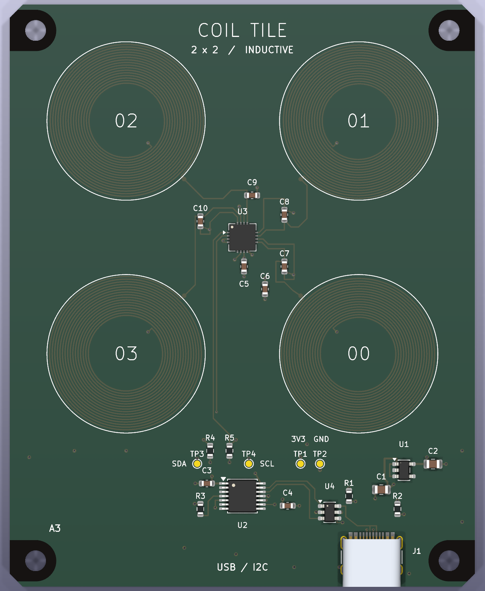

# CoilTile A3 — a four-pixel metal-sensing PCB

**Prototype design, not yet fabricated or tested on hardware.** Four printed
24 mm coils sense changes in nearby conductive targets. An LDC1614 measures
their resonant frequencies; an MCP2221A connects them to a USB desktop heatmap.
This is a near-field inductive array, not radar or an RF direction-finding array.

A3 keeps the continuous USB-C → ESD → USB/I²C bridge → sensor → LC-tank
schematic, with smaller symbols, tighter spacing and clear service notes.
The PCB has shorter I²C/CC1 routes, labeled service pads and a closer sensor
bypass capacitor. All four mounting holes retain the American Embedded
exposed-substrate footprint used by the flyback and GaN examples.
See [A3 changes and measured routing improvements](docs/A3-CHANGES.md).

[View the schematic PDF](docs/CoilTile-schematic.pdf) · [Angled 3D view](evidence/assembled-board-perspective.png) · [3D model details](docs/3D-MODELS.md).

## What is included

| Folder | Contents |
|---|---|
| `kicad/` | Editable KiCad 9 project, schematic, routed PCB, local symbols and footprints |
| `docs/CoilTile-schematic.pdf` | Readable one-sheet A3 schematic |
| `manufacturing/` | Fabrication ZIP, JLCPCB BOM and placement CSV, order notes |
| `software/` | USB driver, 2×2 heatmap, baseline calibration, CSV logger, explicit demo mode |
| `planar-studio/` | Coil configuration, generated artwork, geometry and estimated model |
| `evidence/` | Native ERC/DRC, netlist, layer/Gerber previews, assembly checks and software tests |
| `scripts/` | Source generators and release/export checks |

Start by opening `kicad/CoilTile.kicad_pro`, then read `docs/BRINGUP.md` and
`manufacturing/ORDER-NOTES.md`. The board is fully routed. There is no firmware
image or programming service to arrange: MCP2221A uses factory USB firmware.
The Python application runs on the computer, not the PCB.

## Design

72 × 90 mm, 1.6 mm FR-4, four copper layers, 20 assembled components on the top.
Four 3.2 mm mounting holes have 6.4 mm exposed-substrate mask openings and 10 mm
copper exclusion circles, with mask extensions toward the nearest side edge.
They retain the 64 × 82 mm mounting pattern and take nylon hardware. The analog converter sits at the
center; USB, ESD protection and a 3.3 V linear regulator occupy the bottom strip.

The four single-layer coils use 16 turns of 0.20 mm trace / 0.20 mm spacing.
Planar Studio estimates about 5.51 µH per coil. A 220 pF C0G capacitor gives an
ideal resonance near 4.57 MHz; routing, materials, targets and mutual coupling
will shift that. Inner coil terminals return on the back. Ground and power
planes are kept outside the sensing disks. Coils remain covered by soldermask.

Four layers were chosen for dependable power and return paths around the USB
bridge and sensor. This costs more bare-board area than two layers, but avoids
a fragile two-layer escape layout. The board uses standard through vias and
no via-in-pad fabrication, blind vias, or solder-mask-defined fine-pitch tricks.

The heatmap shows relative frequency changes. It does not claim distance,
material identity, four independent spatial pixels, or a validated detection
range. Start experiments with coins/washers a few millimeters away. Backside
metal also affects it. Use a plastic stand and keep a laptop chassis away.

## Cost and assembly

Planning allowance: **roughly US$85–120 for five assembled boards before
shipping/tax**, not a JLCPCB quotation. The two main ICs account for most of the
parts cost. Small-order setup, extended-component fees, stencil, QFN inspection,
connector soldering and wastage can outweigh the bare PCB price. Actual service
eligibility, stock and all fees must be checked in JLCPCB's order review.

All purchased parts have exact LCSC codes in the native schematic and BOM.
The coils, test pads and mounting holes are fabricated features, not BOM parts.
Request complete top-side assembly including the USB connector's shell stakes.
No order has been placed. A cable and nylon standoffs are not included in the BOM.

## Verification and remaining work

KiCad 9.0.9 ERC and DRC report **zero violations**, zero unrouted connections,
and zero schematic parity issues. BOM and CPL both contain exactly the same
20 assembly references. Gerber copper/mask/paste/silk/outline files were parsed
and rendered separately from the native PCB. Schematic PDF and layer views
were visually reviewed. Seven mocked driver tests pass; headless demo/CSV runs.

These checks cannot verify oscillation amplitude, USB signal integrity, sensor
noise, usable range, crosstalk or assembly yield. The first batch is for bring-up
and characterization. The GUI/USB path still needs a real-machine/device run.
See `docs/VALIDATION.md` for the exact boundaries of the verification.

## References used

Built using the [KiStack](https://github.com/American-Embedded/kistack) schematic,
PCB, BOM and export workflows, and
[Planar Studio](https://github.com/jonahsaunders/planar-studio)'s actual inductor
engine. Reviewed its planar-flyback example generators, schematic and layout
audits for portable libraries, winding artwork/net-tie handling, readable
schematics and release checks. Those examples are not proof this sensor works.

Commit pins, datasheet links, licenses and design choices are in
`docs/REFERENCES.md`. See `docs/REBUILD.md` before running the generators: they
overwrite the native design files, so edit in KiCad or regenerate deliberately.
