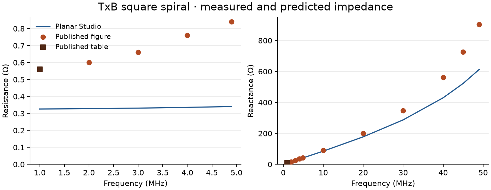

# Measured square-spiral inductor

This example reconstructs the TxB inductor fabricated and measured by Jacopo
Olivo, Sandro Carrara and Giovanni De Micheli. Their network analyzer measured
scattering parameters, which the authors converted to terminal impedance. The
fixture dimensions and calibration plane are unspecified. The editable
reconstruction uses the published dimensions and Planar Studio's standard
terminal routing. [Original paper, Tables I–II and Figure 3(b)](https://si2.epfl.ch/demichel/publications/archive/2011/ISMICT_2011_Jacopo_%28Antenna_Design%29.pdf)

| Quantity | Published measurement | Planar Studio | Relative error |
| --- | ---: | ---: | ---: |
| Inductance | 1.53 µH | 1.336 µH | −12.7% |
| Resistance at 1 MHz | 0.56 Ω | 0.326 Ω | −41.7% |
| Reactance at 1 MHz | 9.76 Ω | 8.396 Ω | −14.0% |
| Self-resonance | 70.4 MHz | 85.48 MHz | +21.4% |

The reconstruction underestimates TxB terminal resistance at 1 MHz. At 49 MHz
it predicts 613 Ω of reactance against approximately 904 Ω in the published plot.

## Self-resonance across three coils

The finite-substrate coplanar-strip model uses published equations and the
generated winding length. No coefficients were fitted. We checked TxA and TxB
during implementation and then evaluated the fixed equations on TxC from the
same study. The comparison includes error in the generated geometry and inductance.

| Coil | Measured MHz | Previous MHz | Updated MHz | Updated error | Published / predicted capacitance (pF) |
| --- | ---: | ---: | ---: | ---: | ---: |
| TxA | 112.2 | 310.20 | 191.38 | +70.6% | 3.42 / 1.614 |
| TxB | 70.4 | 123.68 | 85.48 | +21.4% | 3.34 / 2.594 |
| TxC (held out) | 32.6 | 45.28 | 33.31 | +2.2% | 2.52 / 2.537 |

The generator fits 4.5 of the five published turns for TxA. It reproduces the
turn counts for TxB (8) and TxC (29). All three resonance estimates run high.
Use a board measurement to establish the operating margin near resonance.
Run `node examples/measured-inductor/resonance.mjs` to reproduce the table.

## Reproduce the comparison

1. In the Inductor workspace, choose **Import…** and open [design.json](design.json).
2. In **Design tools → Measurements**, import [impedance.csv](impedance.csv)
   to overlay measured impedance magnitude on the model.
3. Run `node examples/measured-inductor/compare.mjs` from the repository root
   for the real and imaginary components at every sampled frequency.
   To redraw the figure, run `python examples/measured-inductor/plot.py` with
   Matplotlib installed.

The paper specifies eight turns, 38 mm across the outside, a 6.6 mm opening,
1 mm traces and gaps, 2 mm corner radius, and 35 µm copper on 1.2 mm FR-4
with relative permittivity 4.4 and air above. Planar Studio specifies a polygon
by its centerline corner diameter. The input of 52.326 mm is
`(38 − 1) / cos(45°)`; the generator steps inward at each corner. The opening
and terminal leads follow the generator. The assumed conductor temperature is
25 °C.

The 1 MHz values and the inductance and resonance measurements come from
Table II. The other CSV values are approximate readings of the solid
measurement traces in Figure 3(b). The resistance and reactance panels use
different frequency ranges. [reactance.csv](reactance.csv) extends the
reactance comparison beyond the published resistance range. One vertical
pixel represents about 0.005 Ω in the resistance panel and 4.3 Ω in the
reactance panel. Line width adds several pixels of uncertainty, especially for
low-frequency reactance. Use the tabulated values for quantitative comparisons
at 1 MHz.
