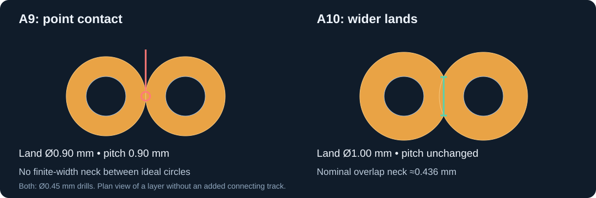

# Planar Studio PCB issues and checks

Use this reference when integrating generated windings into a routed PCB. The incidents below were found in the 5 W flyback example. A10 retains the A8/A9 winding-short repairs, adds turn-spacing and annular-ring margin, and fixes tangent via lands. These incidents demonstrate limits of earlier validation and ordinary net-tie DRC; they do not establish that every Planar Studio design has these defects or that the application verifies every possible geometry.

The generator's nominal dimensions, a clean DRC report and a continuity beep are not sufficient evidence that current follows the intended turns. Check the actual copper, its layer transitions and the final fabrication exports.

## Recorded defects

| Issue | Observed design | Why it escaped | Correction and prevention |
| --- | --- | --- | --- |
| External track shorts a winding turn | A7: the 1.2 mm SW landing at T1.2 overlapped F.Cu winding copper by about 0.075 mm. A second 0.8 mm approach left about 0.125 mm clearance. | Primary pads 1, 2 and 5 belong to one net-tie group. DRC allows their intentional DC connection; pad-center tests ignored the incoming track width. | A8 narrowed the final 1 mm of both SW approaches to 0.6 mm. A9 and A10 retain those necks at the relocated terminal. Check track/via/pad/pour outlines against each winding, with only local, layer-specific terminal contacts permitted. |
| Actual turn spacing is smaller than the generator setting | A7/A8: a 0.20 mm setting produced about 0.19105 mm. A9: a 0.25 mm setting produced about 0.23978 mm on all four layers. | The setting controls nominal pitch minus width, not minimum perpendicular distance everywhere. Each layer is one polygon, so ordinary object-to-object DRC did not test its internal gaps. | A10 uses 0.30 mm nominal spacing and measures about 0.28872 mm, with a conservative 0.28572 mm bound. Both must meet a 0.260 mm CAD threshold. The regression suite rejects A8 and A9 artwork under the current requirement. |
| Adjacent via lands touch at a point | A9: two secondary pairs had 0.90 mm lands on 0.90 mm pitch. Eight layers/pairs had tangent copper contacts without a connecting track. | Minimum connection width was 0.0 mm. Enabling warning categories alone left the threshold ineffective. Circle polygonization also makes a single-layer erosion test unreliable at exact tangency. | A10 enlarges four lands to 1.00 mm around unchanged 0.45 mm holes. Ideal overlap neck is about 0.436 mm. A 0.20 mm connection-width rule is now an error; a native DRC regression rejects all eight A9 contacts. |
| Annular-ring margin is checked against an overly permissive global rule | A9 T1 lands were 0.60/0.30 mm, giving 0.15 mm rings, while the global rule permitted 0.10 mm. No open was observed. | Passing a configured minimum does not establish preferred process margin; T1 holes serve as filled/capped interconnects and need explicit requirements. | A10 T1 lands are 0.70/0.30 mm, giving 0.20 mm rings. An independent T1 check rejects the old size. The ordinary via minimum is 0.15 mm. Recheck all layers before enlarging lands near windings. |
| Clean DRC omits meaningful mask/connection limits | A9 had zero minimum connection width and zero mask-to-unrelated-copper clearance. | An enabled category with a zero limit provides little protection. | A10 requires 0.20 mm connection width, 0.09 mm mask clearance and 0.30 mm hole-to-copper clearance. Guard checks fail if these limits are reduced; all copper/mask Gerbers are compared with the saved board. |

The A7 landing defect was a short; the A7/A8 turn gaps were positive but below the project's 0.20 mm rule. A9 passed that rule but did not achieve an actual gap above 0.25 mm. The tangent via contacts joined the same net and were not the sole DC path: removing all eight contacts did not change pad connectivity. Thin annular rings were a margin concern, not an observed open. Keep these distinct when reporting severity.

JLCPCB lists a generic 0.25 mm same-net spacing rule and a separate 0.15 mm minimum for covered 1 oz coils. A10's measured turn gaps exceed both, avoiding reliance on that classification difference. T1's 0.20 mm rings meet the published recommended multilayer 1 oz PTH ring dimension. These are CAD dimensions, not guarantees of finished tolerances. [Manufacturer capabilities](https://jlcpcb.com/capabilities/pcb-capabilities).

## Checks that catch these failures

1. **Check the completed copper, including route widths.** `scripts/verify-winding-clearance.py` checks tracks, vias, plated pads and filled zones against all four winding polygons. T1's intended connections are F.Cu: pads 1/5; B.Cu: pads 2/5; In1.Cu and In4.Cu: pads 3/4. A pad belongs to a particular winding end; its net name does not permit contact anywhere along that winding. The checker allows contact only near the appropriate terminal and on the appropriate layer.
2. **Measure gaps within each winding.** `scripts/verify-winding-integrity.py` checks nonadjacent centerline segments, bounds the final copper to the intended stroke envelope, rejects missing/extra copper, and measures the saved polygon edges at the tightest nominal turn pair. With `--gerbers manufacturing/gerbers`, it also requires the four exported winding regions to equal the checked native polygons.
3. **Check the intended current path.** `scripts/export-copper-geometry.py` plus `scripts/audit-winding-topology.py` reconstruct physical connectivity across six layers and plated barrels. Virtual cuts through winding conductors must break the expected path. Each parallel secondary is tested separately so the other branch cannot hide a bypass. This catches the original A7 shortcut even though VIN and SW are intentionally DC-connected through the primary.
4. **Rerun native rules and export checks.** ERC, all-category DRC, schematic parity, board/core-edge clearance, terminal attachment, package mapping and manufacturing-data checks remain necessary. Independent winding checks complement them.
5. **Check rule values and land geometry.** `verify-clearance-rules.py` verifies nonzero constraints, T1 annular rings and analytic overlap of paired via lands. `test-clearance-rules.py` retains the actual A9 native-DRC failure and rejects disabled limits or thin T1 lands.
6. **Validate saved fills and every copper/mask export.** The generator reloads and refills the saved board after restoring project rules. `audit-board-clearance.py` independently measures copper, hole, edge and mask distances. `verify-gerber-geometry.py` decodes all six copper and both mask files and rejects added/missing geometry outside a 0.0003 mm approximation envelope. A temporary DRC refill is not a saved manufacturing artifact.

The integrity checker is scoped to this example's simple two-turn-per-layer paths. It excludes segments less than 2 mm apart along the path as adjacent conductor, and allows a 0.0015 mm stroke-envelope tolerance. The virtual-cut test skips terminal lands and cuts that cannot fully sever a short corner segment. These are explicit limits, not general proofs for arbitrary branched, tapped or tightly folded artwork. Review and extend the checks when using another winding topology.

## Related integration pitfalls

| Pitfall | Practical check |
| --- | --- |
| Increasing spacing moves terminals and attached routes | Recheck every affected approach and all layers. In A9, the 1.3 mm SEC_A route end would have left only 0.372 mm to the core opening after its terminal moved. Its final 1 mm now narrows to 0.6 mm, and the 0.50 mm board-edge rule passes. |
| Enlarging pads moves copper toward the core slot | A10's initial larger T1.4 land left only 0.452 mm to the slot. Increasing the winding outer-size setting from 13.6 to 13.9 mm restores the 0.50 mm edge requirement while retaining the same openings. Primary terminal offsets increase to 0.30 mm to clear the opposite winding layer. |
| A plated terminal touches a winding on an unintended layer | Evaluate the full pad diameter and barrel on every copper layer, including layers without a winding. Do not check only the layer where the external track is drawn. |
| Continuity testing appears to confirm a shortcut was removed | An intended winding already connects its terminals at DC. A continuity beep across two nearby points cannot distinguish the full winding from a bypass. Use visual copper inspection and appropriately isolated inductance/turns-ratio measurements. |
| Centerlines are correct but copper was widened, filled or bridged | Check both missing copper and extra copper against the intended path. A test that merely confirms every centerline point lies inside copper will also pass a solid copper sheet. |
| Correct native PCB, stale manufacturing ZIP | Regenerate Gerbers and drills after edits. Match native-board and export hashes, compare the exported winding regions, and use the BOM/CPL from that same package. |
| A scripted board save resets project rules | KiCad's Python `SaveBoard` can write default project settings from a fresh board. Restore explicit constraints, load them into the board before the final refill, and save with `aSkipSettings=True`. Check the saved project's limits and severity settings as well as DRC results. |
| Correct PCB, incorrect assembly preview | Manufacturer placement datums and angles can differ from KiCad's. Check actual pad/pin locations and polarity in the fresh factory preview; see the placement review in this package. |

## A10 disposition and evidence

The 0.6 mm width, four primary turns, two secondary turns, series/parallel connections, core pair, stack, electrical values and component placements remain intact. Nominal spacing is 0.30 mm, outer-size setting 13.9 mm and both outer primary terminal offsets 0.30 mm. T1 lands are 0.70/0.30 mm. Terminals, the internal series transition and eight attached approach segments move with the generated geometry. The existing SW and SEC_A necks remain. Four secondary via lands increase to 1.00 mm; their centers and 0.45 mm drills are retained. Other routes, via centers/drills and board/core openings are unchanged.

The estimated magnetizing inductance remains 13.12 µH. DC resistance becomes 0.32986/0.08138 Ω primary/secondary, about 1.75%/1.46% above A9. Leakage/capacitance estimates are regenerated. Physical magnetic, fault, thermal and EMI performance still require prototype measurements.

- [Repair history](WINDING-CLEARANCE-REVISION.md)
- [A10 clearance and via-land repair](CLEARANCE-A10-REVISION.md)
- [Current validation and scope](VALIDATION.md)
- [Spacing and Gerber checks](evidence/audit/winding-integrity-checks.json)
- [External copper clearance](evidence/audit/winding-clearance-checks.json)
- [Physical connectivity and virtual cuts](evidence/audit/copper-topology-checks.json)
- [A9-to-A10 change containment](evidence/audit/a10-revision-checks.json)
- [Rule and land checks](evidence/audit/clearance-rule-checks.json)
- [Whole-board clearances](evidence/audit/board-clearance-checks.json)
- [All copper and mask exports](evidence/audit/full-gerber-geometry-checks.json)
- [Placement review](manufacturing/PLACEMENT-REVIEW.md)

The rebuild runs fourteen regression cases covering correct copper, old 0.191/0.240 mm gaps, added/missing winding copper, wide terminal lands, insufficient clearance, a via on the winding, tangent via lands, disabled connection-width limits and thin T1 rings. Preserve these failing examples. Record future issues with the affected revision, measured geometry, reason the existing check missed it, repair and a regression case that fails the original defect.
