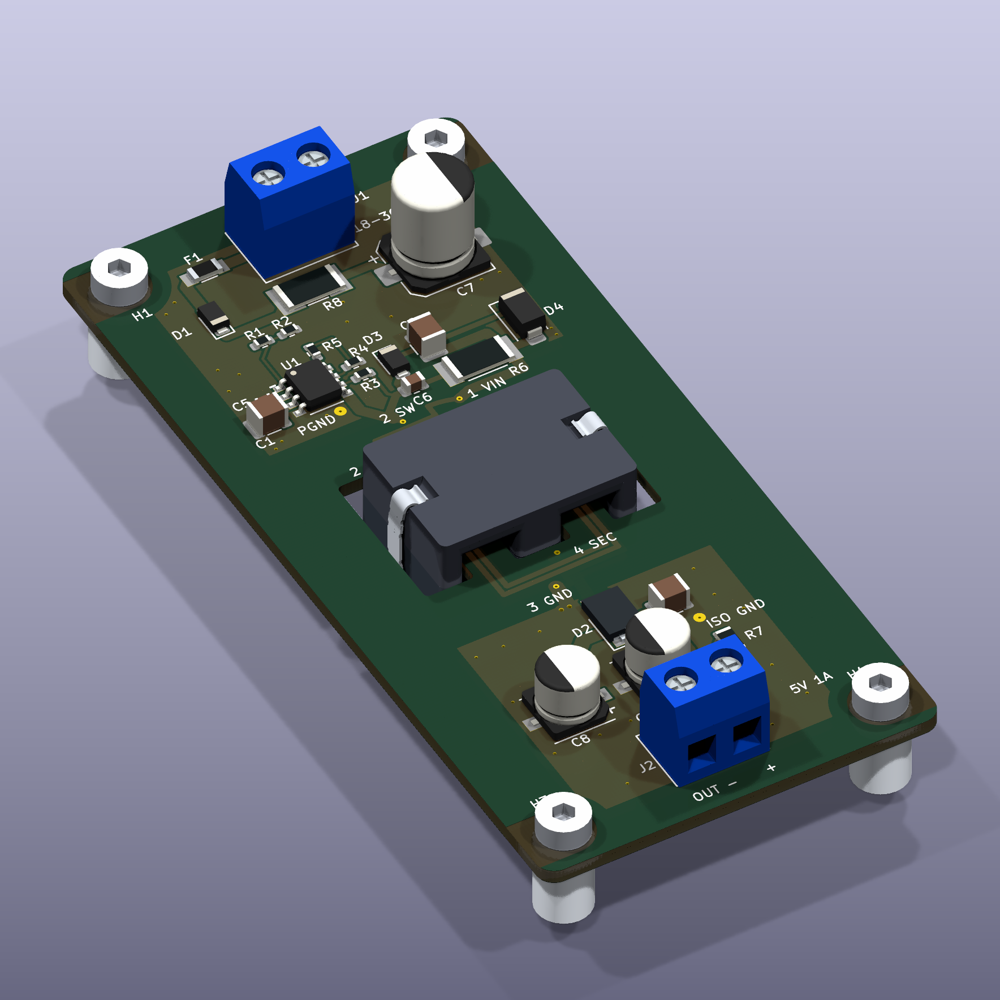
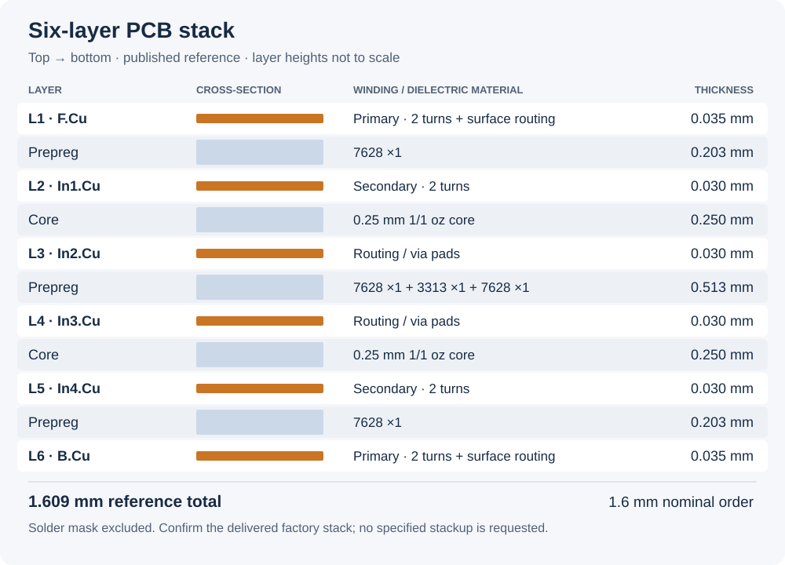
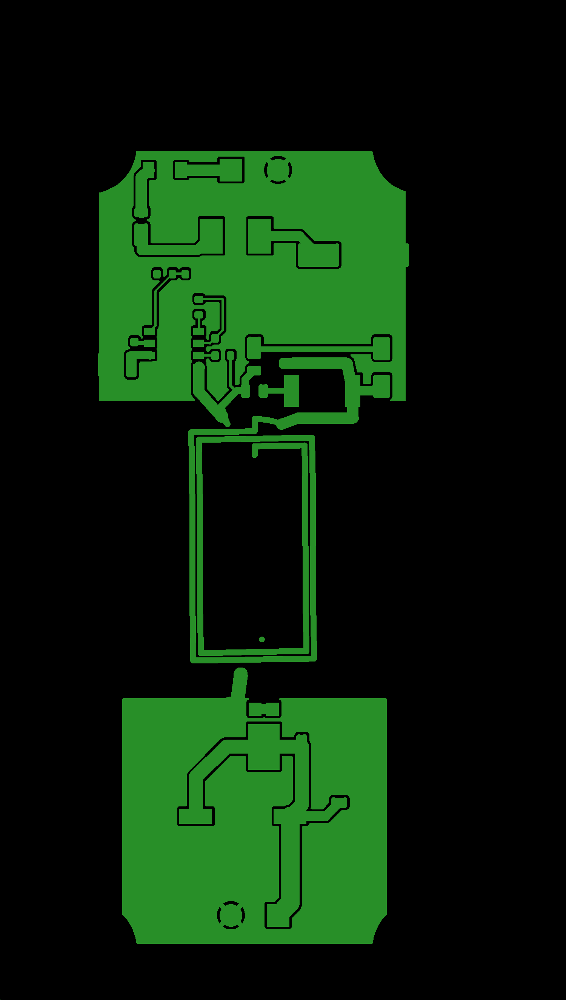
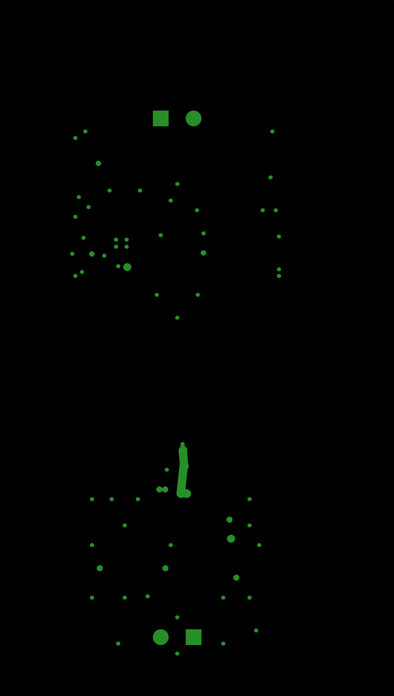
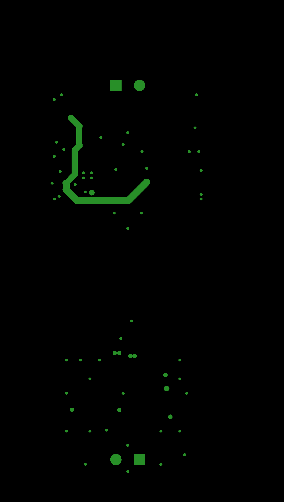
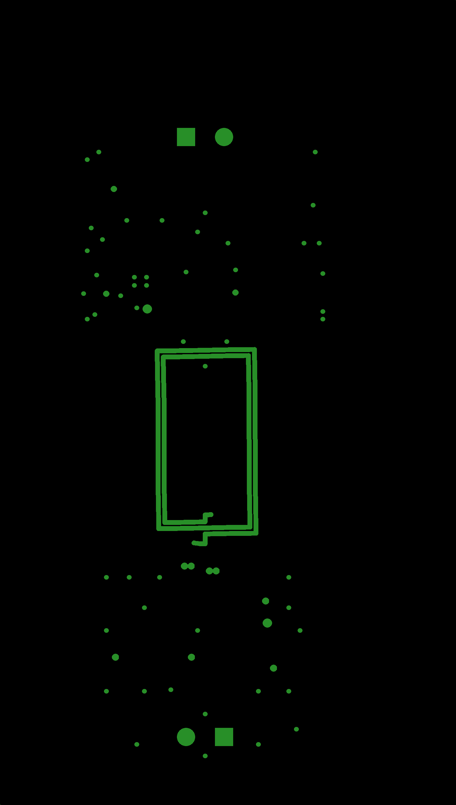
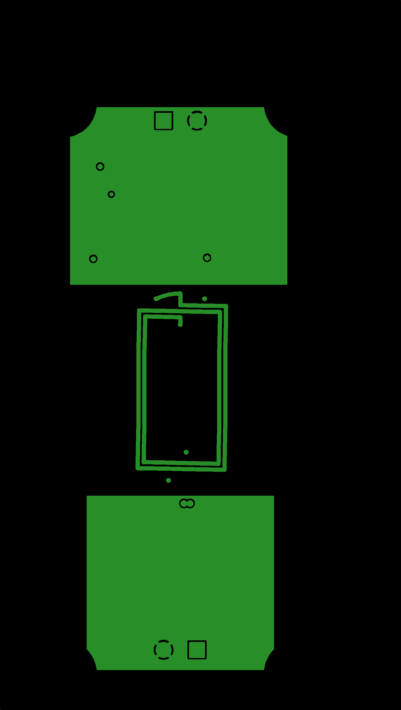
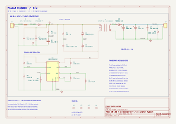

# PS-FLYBACK-5W A8 — corrected SW-to-winding clearance

An engineering prototype for 18–36 V input and isolated 5 V / 1 A output. [Review report](report.html) · [Validation](VALIDATION.md) · [Manufacturing handoff](manufacturing/START-HERE.md).

**A8 supersedes A7 for fabrication.** A7's 1.2 mm SW approach overlapped the F.Cu primary winding by approximately 0.075 mm; the other 0.8 mm approach also violated the 0.20 mm clearance. Both routes now narrow to 0.6 mm for their final 1 mm into T1 pad 2. The nominal minimum gap is approximately 0.225 mm. [Repair details](WINDING-CLEARANCE-REVISION.md).

The new check evaluates actual track, via, pad and filled-zone copper against every winding layer, allowing only local intended terminal contacts. It rejects A7 and passes A8 independently of KiCad's net-tie exemption. [Clearance evidence](evidence/audit/winding-clearance-checks.json) · [A7-to-A8 comparison](evidence/audit/a8-revision-checks.json).

A8 retains the A7 **OSP** finish and **649 kΩ R1 / C25821**, the **180 Ω / 0.25 W R7**, and the existing winding, stack, component placements and circuit values. Earlier procurement stock figures are historical snapshots. [R1 procurement](PROCUREMENT-REVISION.md) · [Preload derivation](PRELOAD-REVISION.md).

The retained 39 Ω / 2 W snubber screens at **0.638 W**. Its repetitive-pulse capability and measured clamp/thermal behavior remain unqualified. [Snubber review](SNUBBER-REVIEW.md).

## 3D assembly

KiCad render of the saved A8 board. [Underside view](evidence/audit/board-3d-underside.png) · [Side view](evidence/audit/board-3d-side.png) · [STEP model](3d/PS-FLYBACK-5W.step) · [GLB model](3d/PS-FLYBACK-5W.glb). Package/core geometry is nominal; mounting hardware and clip retention include provisional envelopes. See [3D model sources and scope](3D-MODELS.md).

## Layer stack

The cross-section uses the published reference in [stackup.json](stackup.json): **1.609 mm excluding solder mask**, ordered as **1.6 mm nominal**. Layer heights in the illustration are not to scale. This is a modeling reference; the delivered factory construction still needs confirmation.

### Individual copper layers

Each image shows one exported Gerber layer in the same top-view orientation and at the same scale. Read left to right, then down, from L1 to L6; click any image for the full resolution.

| L1 · F.Cu — top | L2 · In1.Cu | L3 · In2.Cu |
| --- | --- | --- |
|  |  |  |
| **L4 · In3.Cu** | **L5 · In4.Cu** | **L6 · B.Cu — bottom** |
|  |  |  |

The primary connects the two-turn windings on **F.Cu and B.Cu in series** for four turns. The two-turn secondary windings on **In1.Cu and In4.Cu connect in parallel**. In2.Cu and In3.Cu carry routing and via pads, with no transformer winding. [Mask, paste, silkscreen and outline views](evidence/audit/gerber-technical-overview.png).

## Schematic

Current A8 schematic exported from KiCad. Open the image to zoom, or download the [native schematic](kicad/PS-FLYBACK-5W.kicad_sch).

## Retained construction

The board is 44 × 94 mm with a 35 × 85 mm mounting pattern and 10 mm copper exclusions around the M3 holes on all six layers. Order nominal 1.6 mm, 1 oz outer / 1 oz inner copper, Specify Stackup: No, OSP finish, and Standard PCBA. The model retains the published default 1.609 mm reference construction; the delivered stack still needs confirmation. [Stack background](STACK-REVISION.md).

The 4:2 planar transformer uses two factory-gapped TDK B66285G0050X187 N87 ELP22 halves and two B66286A2000X000 spring clips. No grinding or adhesive is specified. Install the core pair after PCBA and measure assembled inductance. All 29 footprints have local visible models. [Core installation](manufacturing/CORE-ASSEMBLY.md) · [3D sources](3D-MODELS.md).

## Checks and remaining work

Native ERC/DRC, schematic parity, package/net mapping, local-change containment, mounting/clip clearance, solid fit and manufacturing export checks are recorded in VALIDATION.md. Standard silkscreen text is at least 1.0 mm high with 0.15 mm strokes and a 0.15 mm clearance rule.

The placement check covers 24 components, 50 saved exact-part catalog pad centers, four R1/R6 manufacturer land centers and two R7 same-series reference centers, with 15 rejected incorrect rotations/origins. Replacement R1/R6/R7 catalog geometry was unavailable; confirm these centered nonpolar placements in the fresh factory preview. [Placement review](manufacturing/PLACEMENT-REVIEW.md).

This remains an unbuilt prototype. Supplier acceptance of the stack, filled/capped vias, panel, Standard-PCBA reflow and connector process is open. Bench qualification must establish clamp and RFB waveforms, snubber pulse/thermal behavior, regulation, magnetics, startup/fault behavior and clip retention. The A8 repair has been checked in CAD; hardware qualification remains open.

## Rebuild

Run `scripts/rebuild.py --kicad-cli <KiCad-10-cli> --kicad-python <KiCad-Python-or-wrapper> --cadquery-python <Python-with-CadQuery-PyGerber-Pillow>`. The default retains the validated winding/core source; `--regenerate-magnetics` explicitly rebuilds those inputs and the revision comparison will reject unintended changes. The build refreshes native files, checks, manufacturing data, views and the A8 review ZIP.

The current A8 evidence is enumerated in VALIDATION.md. Earlier A1–A7 reports and images are historical context, not fresh proof for this board.
