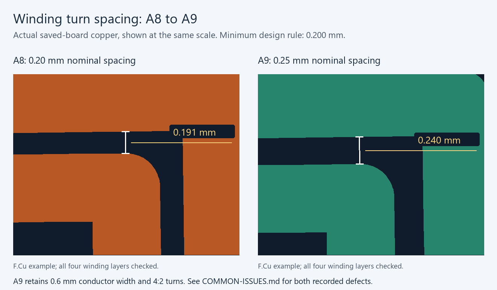
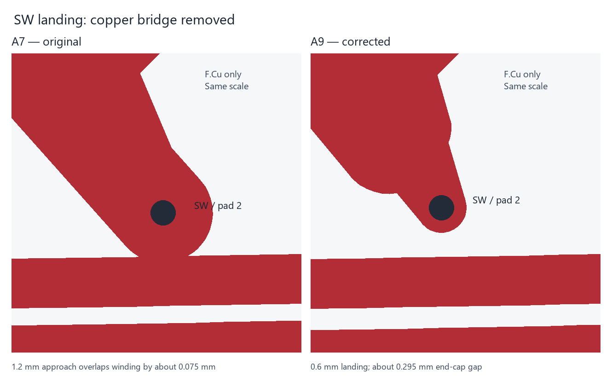

# A9 winding spacing and terminal clearance

A8 repaired the SW shortcut but still had about 0.19105 mm between turns on all four winding layers. The generator’s 0.20 mm setting describes nominal pitch minus width; it does not guarantee the perpendicular distance at sloped rectangular-spiral corners. Ordinary DRC did not inspect internal spacing within the single winding polygon. The previous independent check covered external copper only.

A9 uses 0.25 mm nominal spacing and a 0.10 mm outward radial offset on both primary terminals. Actual copper at the tightest nominal turn pairs measures about 0.23978 mm; the conservative global nonlocal-segment bound is 0.23678 mm. Width remains 0.6 mm and turns remain 4:2. The regenerated terminal coordinates and transition position move slightly, and attached routes follow them. The two SW necks remain 1 mm long and 0.6 mm wide. The inner-layer SEC_A landing also narrows to 0.6 mm for 1 mm to preserve 0.50 mm clearance to the core opening after its terminal moves.

The circuit values, component placements, external vias, core, stack and board/core-slot outlines remain intact. The A8-to-A9 comparison bounds the permitted changes and the resulting local pour changes. Winding resistance, leakage and capacitance calculations are regenerated; nominal magnetizing inductance remains 13.12 µH.

`verify-winding-integrity.py` measures internal spacing, checks both missing and extra copper, and compares the exported winding Gerber regions with native polygons. Four regression cases complement the five external-contact cases. The Shapely topology audit independently checks six-layer physical connections and virtual cuts along winding conductors. All are part of the A9 rebuild; their scope and exclusions are documented in [COMMON-ISSUES.md](COMMON-ISSUES.md).

The native schematic and PCB drawing layer link the repair to the common-issues reference. Use matching A9 native, Gerber, drill and assembly files. A7 and A8 are historical packages. Supplier acceptance and measured hardware qualification remain open.

## Historical A8 repair

### SW terminal repair introduced in A8

A7's wide SW approach to T1 pad 2 overlapped the front primary winding by approximately 0.075 mm. The other SW approach left only approximately 0.125 mm clearance. The primary is a net tie, so ordinary KiCad DRC permitted those nets to join. The old pad-center and winding-centerline checks did not inspect the incoming trace widths.

A8 narrows the final 1 mm of each approach to 0.6 mm, matching the primary winding width. The rest of each route retains its original width and centerline. The resulting nominal edge clearance to F.Cu winding is approximately 0.225 mm, above the board's 0.20 mm rule. Winding artwork, pads, vias, components, placements, stack and board/core-slot outlines are unchanged. No components or jumper wires are added.

The new `verify-winding-clearance.py` checks actual routed copper, vias, plated pads and filled zones against all four winding polygons. Intentional connections are permitted only within a 0.8 mm radius of the correct terminal for that layer and net. This check operates independently of net-tie DRC permissions. Its polygon conversion tolerance is 0.0005 mm; the clearance check conservatively accounts for conversion tolerance.

`verify-a8-revision.py` compares against A7 commit `8dca6ed98bcd7ba8268f86910679d13682896f17`, verifies the two local route changes and confirms that the original A7 fails the new clearance gate. It bounds integer-coordinate refill slivers to less than 0.00001 mm² within the local SW route envelope. `test-winding-clearance.py` exercises five passing/rejection cases, including a restored short, insufficient clearance without a short, an added via and an oversized pad.

The rebuild runs these gates before manufacturing export. Native ERC/DRC, all-category DRC, schematic parity, placement, manufacturing agreement and existing geometry checks are also rerun; see [current validation](VALIDATION.md). This paragraph records the A8 repair only. A9 now supersedes A8. Earlier A7 archives remain historical and must not be used for this corrected build.

This repairs the identified CAD fault. It does not establish measured efficiency, current capability, thermal margin, isolation performance or first-article acceptance. Inspect the SW landing and verify the assembled primary inductance and turns ratio during bring-up as described in the prototype test plan.
