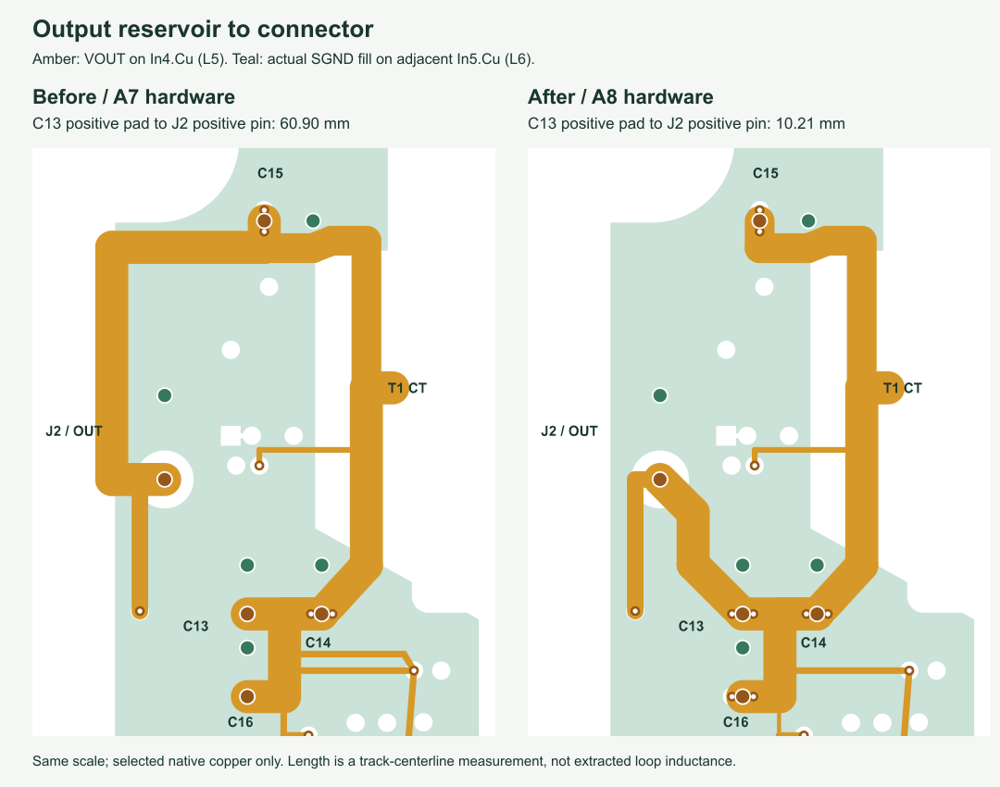

> Historical design study. A11 manufacturing repairs and current measurements are in [README.md](README.md), [VALIDATION.md](VALIDATION.md) and [Manufacturing-audit.html](Manufacturing-audit.html).

# A10 schematic / A8 hardware: return paths and output distribution

Reviewed 10 October 2026. This pass adds six creator resources to the three
covered in the [previous video review](VIDEO-LAYOUT-REVIEW.md). The listed
public caption sections were read; this is not a claim of watching every
frame or reproducing the creators' field simulations. Manufacturer guidance
was checked before applying general advice. No creator endorses this board.

## Resources and their application

| Resource | Caption sections reviewed | Decision on this board |
| --- | --- | --- |
| [Rick Hartley / Robert Feranec: Ground in PCB Layout — Separate or Not Separate?](https://www.youtube.com/watch?v=vALt6Sd9vlY) | 9:06–18:53; 23:14–27:10 | Keep sensitive circuitry over its own continuous reference. Preserve this GaN device's specifically required AGND/PGND separation and the converter's isolation barrier; do not merge grounds as a generic rule. |
| [Robert Feranec: How GND VIAs Improve Your PCB Layout](https://www.youtube.com/watch?v=nPx2iqmVAHY) | 0:00–11:40 | Add a reference-transfer via at the LI layer transition; preserve the previously improved GD1/VG2 returns. Require each stitch to touch at least two actual filled same-net planes. |
| [Phil's Lab #88: Mixed-Signal Hardware/PCB Design Tips](https://www.youtube.com/watch?v=v6fTa6LRJLI) | 3:30–14:00 | Extend the closest reference plane under the feedback and controller banks. Keep the quiet secondary, controller ground and bias-power domains distinct where required. |
| [Phil's Lab #131: PCB Design Final Touches](https://www.youtube.com/watch?v=g4m91gv-4oQ) | 4:57–10:59; 14:40–17:00; 20:14–23:00 | Inspect actual filled copper, remove avoidable reference-plane cuts, add parallel power transitions, then recheck parity, solder-mask/fabrication outputs and assembly files. |
| [Phil's Lab #133: PCB Silkscreen & Solder Mask 101](https://www.youtube.com/watch?v=f1jH4roZfgE) | 4:34–8:00 | Retain readable port polarity and board revision, keep full component references in the assembly drawing, and verify mask/paste and unchanged top-side placements. No new decorative markings crowd the routing. |
| [Phil's Lab #156: PCB Crosstalk Basics](https://www.youtube.com/watch?v=lLknjLemY-M) | 7:10–12:30; 17:30–23:50 | Improve field containment by bringing a reference closer and removing its interruptions. Do not claim a crosstalk voltage or emissions improvement without extraction or measurement. |

The specific ground exception comes from
[LMG2100R044 §8.4](https://www.ti.com/lit/ds/symlink/lmg2100r044.pdf).
The rectifier sense/drive constraints are checked against
[UCC24624 §11](https://www.ti.com/lit/ds/symlink/ucc24624.pdf), and the bias
feedback separation against [LM5164 §7.4](https://www.ti.com/lit/ds/symlink/lm5164.pdf).

## Changes implemented

1. **Local reference copper.** Extend SGND on In1.Cu beneath the lower
   secondary feedback/OVP bank; add a bounded AGND region below the LLC
   controller; extend the PGND reference below the bias feedback/ripple
   network. The upper AGND region now covers the GaN logic-input escape.
   Ground domains remain separate. The winding artwork and switching-node
   exclusion are unchanged.
2. **Remove reference-plane interruptions.** Move the raw DC input feed
   from In1.Cu to In6.Cu, keeping its existing XY path and width. Move the
   short optocoupler LED and compensation branches off In1.Cu to In4.Cu,
   adjacent to the existing SGND plane. Move OC, feedback-collector and
   VD1 sensing routes to In2.Cu with adjacent same-domain ground. Remove
   the redundant long R5-to-C6 ground trace; both pads connect directly
   through their vias to the local AGND planes.
3. **Shorter output distribution.** Feed J2 from C13/C14 rather than taking
   the output rail around the upper rectifier and board perimeter. Keep
   the 2 mm rail width. Remove the redundant loop in the low-current
   divider feed; its shortest physical route remains about 6.05 mm.
4. **Parallel power vias and local returns.** Add two VOUT and two SGND
   vias at each of C13 and C16. Each of those pads now has three circuit
   vias. A new AGND return sits 1.05 mm from the LI transition, previously
   2.797 mm. The three earlier GD1/VG2 improvements are retained. After
   clearance-aware reselection there are 60 stitches, not a blanket increase
   in via density: 25 PGND, 13 AGND and 22 SGND. Total routed vias: 215,
   including 155 circuit vias, plus six winding transitions.

| Measured geometry | Previous A7 hardware | Current A8 hardware |
| --- | ---: | ---: |
| C13 positive pad → J2 positive pin | 60.899 mm | **10.206 mm** |
| C14 positive pad → J2 positive pin | 56.399 mm | **14.706 mm** |
| LI transition → nearest AGND via | 2.797 mm | **1.050 mm** |
| GaN commutation pad-center area | 7.0817 mm² | 7.0817 mm² |
| Foreign copper under full primary SW projection | none | none |
| Parts moved / changed identities | — | **0 / 0** |

Lengths are shortest explicit centerline paths, splitting collinear overlaps
and same-layer intersections and including plated connector transitions.
They omit vertical barrel length and copper-spreading shortcuts; they are
not resistance or inductance extraction. The removed redundant divider
loop is not misreported as shortening a path that already existed.
[Full comparison](evidence/A10-layout-audit.json).

## Verification and limits

Seventeen selected signal nets have **100% sampled centerline coverage by
filled same-domain ground on an immediately adjacent layer**, outside a
0.65 mm radius around their own signal vias. Raw coverage is also reported;
foreign-net voids are never excluded. The audit follows every explicit
segment of the selected nets, including their internal-layer branches.
This is a defined geometry screen, not a claim about every net or actual
return-current density. [Reference-plane audit](evidence/reference-plane-audit.json).

ERC, DRC, schematic parity, winding contacts, assembly mapping and existing
GaN/drive-reference checks pass. The schematic circuit, all 75 purchased
top-side placements, footprints, port orientation, 55 × 47 mm mounting
pattern and transformer geometry are preserved. The schematic revision
changes only to identify the matching package. Independent fabrication
renders and a clean-copy rebuild are included in [VALIDATION.md](VALIDATION.md).

The [component-rating findings](COMPONENT-RATINGS.md) remain applicable.
There is no new efficiency, EMI, temperature or control-stability measurement.
Magnetics heating, capacitor effective capacitance/ripple, transients and
startup/fault protection still prevent electrical release. JLCPCB must
accept the exact stack and filled/capped-via assembly process. These changes
improve the layout geometry; they do not qualify a 60 W product.
