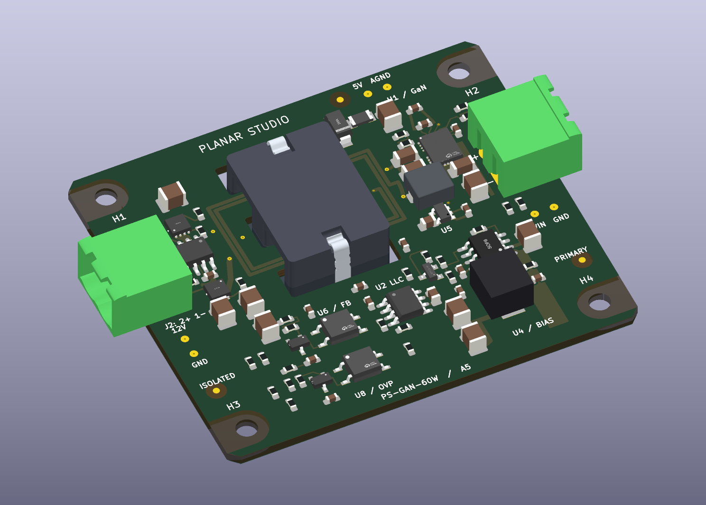
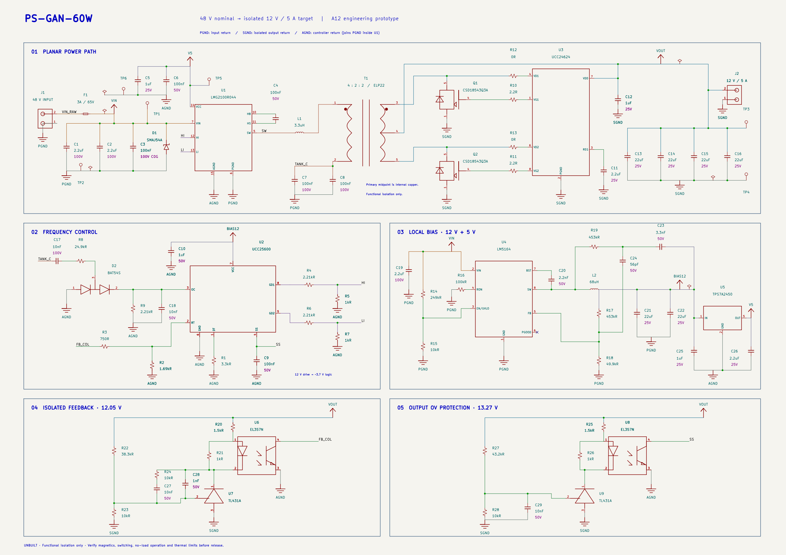

# PS-GAN-60W — planar GaN LLC example

An editable KiCad 10 prototype targeting **48 V nominal input and isolated
12 V / 5 A output**, using an integrated GaN half bridge and PCB transformer.
Initial input range: **46–50 V**. **Unbuilt and untested; 60 W is a target.**

**Manufacturing audit, five boards: DO NOT ORDER this revision.**
The [manufacturing report](Manufacturing-audit.html) documents overlapping
U5/C26 lands, incomplete courtyards, GaN mask/paste and placement-origin issues,
the factory stack mismatch, and required panel/core-assembly acceptance.
All 43 electronic catalog codes currently cover five fitted boards before
attrition. Budget **$400–650 total**, excluding shipping, taxes, ferrite fitting
and functional testing; this is an allowance, not a supplier quote.
Full turnkey assembly is **not confirmed**. Native A10/A8 CAD is unchanged by
the audit; the native-generated BOM now explicitly includes MPN/manufacturer.



## Schematic and layout



**A10 schematic / A8 hardware** applies a [deeper creator-resource review](DEEP-LAYOUT-REVIEW.md)
and retains the [reference-by-reference component audit](COMPONENT-RATINGS.md).

- Shortens the C13-to-output-connector rail from **60.90 to 10.21 mm** and
  the C14 route from **56.40 to 14.71 mm**, with parallel capacitor vias.
- Provides adjacent filled-ground coverage along 17 selected signal nets,
  outside their own via clearances. Removes routes that interrupted those
  reference planes and adds a closer return at the GaN LI transition.
- Has **60 verified ground stitches and 215 routed vias**; AGND, PGND and
  the isolated secondary retain their required separation.
- Retains the previous ratings corrections: 3 A / 65 V fuse, 100 V C17,
  high-power 0603 R20/R25 and 24.9 kΩ R8.
- Preserves every part position, the 64 × 56 mm outline, 55 × 47 mm M3
  pattern, removable headers, top-only assembly and compact GaN loops.

**Electrical release remains on hold.** Transformer heating, capacitor ripple
and effective capacitance, switching transients, and startup/fault protection
need validation. The ratings table distinguishes calculated screens from
unresolved qualifications; 60 W is still an unbuilt target.

See [A10 layout measurements](evidence/A10-layout-audit.json),
[GaN checks](evidence/GaN-layout-audit.json),
[stitching](evidence/stitching-audit.json) and the
[validation record](VALIDATION.md).

HS and SW are connected internally in the LMG2100. The external bootstrap return
now connects only C4 to HS, eliminating the external SW–HS loop. The drawing
retains the readable local wiring, distinct VD1/VG1 routes, vertical C11,
uncrossed J2 wires and zero four-way connections. R16 still correctly connects
RON through 100 kΩ to PGND; D1 retains its unidirectional TVS polarity.

The [datasheet pin review](evidence/datasheet-pin-review.json),
[schematic geometry checks](evidence/schematic-geometry.json) and
[readability check](evidence/readability-audit.json) are refreshed for A10.

The outline shrinks from 80 × 58 to **64 × 56 mm**, about **23% less PCB area**,
while preserving the winding geometry and all-top electronics. This compares
outline bounding areas, not complete assembly volume. Headers overhang the
edges; mating plugs, wiring and service clearance add to the envelope.


- **64 × 56 mm** chamfered board; eight copper layers, nominal 1.6 mm thickness.
- Four **3.2 mm M3 holes** reuse the actual exposed-substrate edge footprint from
  the flyback example: 6.4 mm mask openings and 10 mm copper exclusions on all
  layers. The **55 × 47 mm** pattern is adapted to this outline; it is not the
  flyback's 35 × 85 mm pattern.
- Two horizontal **5.08 mm pluggable screw-terminal ports** face opposite edges.
  Removable plugs accept bench leads without soldering; plugs are listed separately.
  J1 is input, J2 is output; **pin 2 = positive, pin 1 = return** on both.
- All **75 purchased components are top-mounted**: 73 SMT and two through-hole
  connectors. The ferrite halves straddle the board. Six bare test pads and
  three optical fiducials are PCB features, excluded from the assembly BOM.
- C15 is placed near the upper rectifier. Local GaN decoupling and winding
  connections stay compact; local bypass and return copper follow the current loops.

The [MIT PER design study](PER-DESIGN-STUDY.md) records the photographs, papers
and specific design decisions. This example has no MIT affiliation or endorsement.

## Circuit and magnetics

LMG2100R044 → 3.3 µH resonant inductor → 4:2:2 planar transformer → silicon
synchronous rectification. UCC25600 provides frequency control, UCC24624 drives
the secondary MOSFETs, and isolated feedback includes a separate OVP path.
LM5164 and TPS7A2450 generate local bias rails.

The winding stack is P / S-A / S-A / routing / routing / S-B / S-B / P, with
70 µm copper requested on every layer. Parallel secondary layers reduce DC
resistance. The retained model estimates **3.69 W of DC winding loss** at the 4 Arms primary / 5 A output thermal screen and 80 °C resistance, before AC and core losses. This remains
a significant thermal constraint, not a high-efficiency claim. Two TDK ELP22 N87 halves, each with a 0.05 mm gap, and two clips are
the separate DigiKey items. Measured inductance, leakage and loss are still needed.

First-harmonic calculations find nominal full-load operating points around
161–192 kHz over the initial input range. They do not prove startup, ZVS,
regulation, thermal performance or no-load operation.

## Open and review

- [Native KiCad project](kicad/PS-GAN-60W.kicad_pro), with local symbols, footprints
  and models; [schematic PDF](Schematic.pdf).
- [Interactive local review](Review.html): open after downloading the example.
  GitHub does not execute this HTML preview.
- [Top assembly drawing](manufacturing-prototype/Assembly-top.pdf), with one clear reference per component.
- [Gerber inspection](evidence/Gerber-review.png), [layout review](LAYOUT-REVIEW.md),
  [copper-layer PDF](PCB-layers.pdf), [validation record](VALIDATION.md) and
  [mechanical dimensions](mechanical.json).
- [JLCPCB sourcing and assembly notes](JLCPCB-SOURCING.md),
  [priced BOM](sourcing/Electronics-BOM-review.csv) and
  [prototype manufacturing files](manufacturing-prototype/READ-BEFORE-ORDER.txt).

The CAD checks pass with zero ERC/DRC violations, zero unconnected items and
zero schematic-parity issues. Factory DFM, exact stack, placement preview,
connector/core assembly and electrical/thermal qualification remain open.
This is an engineering example, not a production-qualified converter.

## Reproduce the checks

Run with Python in UTF-8 mode. KiCad's bundled Python supplies `pcbnew`.

```text
python -X utf8 scripts/export_review.py /path/to/kicad-cli
python -X utf8 scripts/audit_device_pins.py
python -X utf8 scripts/audit_schematic.py
python -X utf8 scripts/audit_readability.py
python -X utf8 scripts/render_gerbers.py
python -X utf8 scripts/audit_windings.py
python -X utf8 scripts/audit_mechanical.py
python -X utf8 scripts/audit_return_paths.py
python -X utf8 scripts/final_audit.py
```

`export_review.py` stops before manufacturing export if ERC or DRC fails.
`engineering_review.py` needs NumPy. `rebuild_board.py` recreates the canonical
board from the included local footprints, placement definitions, manual routes
and mechanical features; it overwrites PCB placement/routing and project rules.
The native schematic is the editable circuit source. redraw_schematic.py
recreates the A10 presentation from circuit.json and the local symbol library;
it overwrites schematic edits, so regenerate only intentionally. It and
audit_schematic.py require the sexpdata package. audit_readability.py also needs
pypdfium2. render_gerbers.py requires PyGerber 2.4.x and Pillow.
audit_layout_changes.py accepts a previous example directory for comparison.
Capacitor ratings are retained in the visible Voltage field and both BOMs.

After intentionally regenerating the schematic, run update_net_aliases.py with
the kicad-cli path, then rebuild_board.py with KiCad Python before exporting.
The alias step matches complete connected-pin sets and refuses topology changes;
it keeps automatically named internal nets consistent with the PCB.

`planar-studio/T1.planar.json` is the **four-section seed**, not the complete
six-winding-layer implementation. `T1-artwork.json` and the native winding/board
files contain the added parallel secondary layers. To regenerate the standalone
winding files, run `node scripts/regenerate_magnetics.mjs /path/to/planar-studio`
against source commit `71f6f4db9c1a7172bddca8c9c934d3a8ece2a481`. This does not
update the main board automatically.

KiStack's schematic, BOM, PCB, symbol/footprint and export workflows were used.
Official manufacturer and JLCPCB/LCSC sources replaced unavailable parts
connectors with the user's approval. See [third-party notices](THIRD-PARTY-NOTICES.txt).
