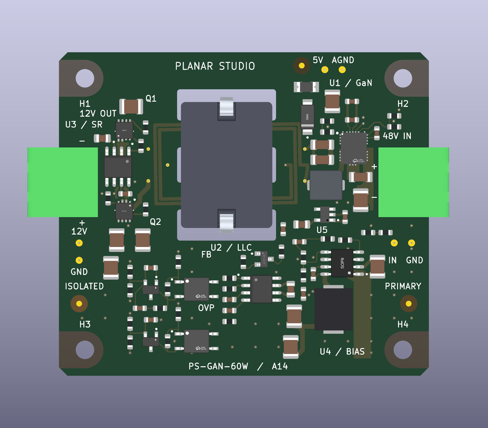

# PS-GAN-60W — A11

48 V nominal → isolated 12 V / 5 A **design target**, with an integrated GaN
half bridge and PCB transformer generated using Planar Studio. Native KiCad 10
schematic, PCB, local libraries, 3D models and reproducible scripts are included.

**Unbuilt engineering prototype. Full turnkey assembly and electrical release
are not confirmed.** Start with [the manufacturing review](Manufacturing-audit.html)
for the repaired CAD findings and remaining factory/qualification gates.

[Design review and copper-layer viewer](Review.html) · [Schematic PDF](Schematic.pdf) ·
[KiCad project](kicad/PS-GAN-60W.kicad_pro) · [Validation](VALIDATION.md)

## A11 manufacturing repairs

- Reconstructed U1 from TI RAR0017B: centered package origin, dimensioned copper,
  independent solder-mask openings and approximately 75–76% power-land paste.
- Corrected the U5 land pattern and separated C26; rebuilt undersized courtyards,
  regrouped/aligned component banks and added visible orientation marks.
- Adopted the observed JLC081622-1080 construction in KiCad and the magnetic
  model: 1.655 mm nominal, 70 µm outer and 61 µm inner copper.
- Named and reviewed every functional pour. Removed isolated islands, retained
  switching-node exclusions, restored adjacent drive return paths and verified
  50 stitching vias against the final filled copper. No AGND/PGND PCB short.
- Added 0.6 mm connector thermal spokes, a coordinate-level filled-drill map and
  a separate [92 × 76 mm handling-panel package](build/panel-A11/README.txt).

The [issue register](manufacturing-prototype/Manufacturing-issue-register.csv)
separates completed CAD corrections from factory process, service and hardware
qualification work. No electronic part identities or circuit values changed.

## Compact construction and bench access

The 64 × 56 mm chamfered board keeps all 75 purchased components on top
(73 SMT + two insertion headers). Four M3 mounts retain the other example's
exact exposed-substrate footprint on this design's **55 × 47 mm pattern**.
The hole spacing differs from the flyback example; the footprint geometry is reused.
Opposing 5.08 mm headers accept removable screw-terminal plugs. Pin 2 is positive
and pin 1 is return on both ports. Mark the cables to prevent a swap.

Six bare test pads provide VIN/PGND, VOUT/SGND and V5/AGND measurement pairs.
Connector bodies, plugs, wire bend radius and the lower ferrite half extend the
assembly envelope beyond the PCB. The header 3D meshes are simplified bodies;
physical mating/fixture clearance still needs review.

The 4:2:2 transformer places its repeatable windings inside the PCB, avoiding a
bobbin and hand-wound coil. Two secondary layers operate in parallel per half.
The tradeoff is an eight-layer heavy-copper construction with filled/capped
transitions, appreciable winding loss and coupling that needs measurement.
[Magnetic calculations](evidence/magnetics.json) report a **3.87 W nominal DC
winding-loss screen at 80 °C**, before AC copper/core loss. This is not a thermal
qualification or an efficiency prediction.

## Manufacturing files and five-board estimate

All 43 exact electronic catalog codes have snapshot stock for five fitted
boards before attrition. [Exact BOM and stock](sourcing/Manufacturing-parts-5boards.csv).
Stock is not reserved. Core halves and clips are specified from DigiKey;
removable plugs are separate accessories. JLC procurement/consignment and
installation of those mechanical items have not been accepted.

Allow **$400–650 total for five boards** ($80–130 each) as a planning estimate
for electronics assembly plus separate cores/clips/plugs. It excludes ferrite
fitting, functional testing, shipping, taxes and duties. The PCB/panel portion
is an engineering allowance; **there is no supplier quote**. Special-process
costs can exceed the allowance. [Itemized model](sourcing/Manufacturing-cost-5boards.csv).

- `manufacturing-prototype/` contains matched **single-board** exports and
  [construction/assembly notes](manufacturing-prototype/READ-BEFORE-ORDER.txt).
- `build/panel-A11/` contains matched **one-up panel** Gerbers, native PCB and CPL.
  Five panels produce five boards. Never combine the panel CPL with single-board
  Gerbers. Review the tab/fixture/overhang process with JLC before release.
- Every 0.30 mm interconnect, including six T1 plated-pad transitions, is specified
  for resin fill, copper cap and planarization. Connector/mounting holes, panel
  mouse bites and tooling holes remain open. Separate coordinate maps are provided.
- Raw KiCad placement rotations require a supplier-model overlay. Review the
  U1 stencil example, mask registration, hidden-joint inspection and THT process.
- Depanelize after soldering/inspection and before fitting the core halves/clips.

No purchase, reservation, supplier message or fabrication upload was made.
A [supplier review draft](manufacturing-prototype/SUPPLIER-REVIEW-REQUEST.txt)
is included, not sent. The [82-reference ratings audit](COMPONENT-RATINGS.md)
retains electrical holds for magnetics, capacitors, input transients and startup/
fault protection. Clean CAD checks do not establish a working 60 W converter.

## Reproduction and provenance

`redraw_schematic.py` reconstructs the schematic from the manifest and bundled
symbols; `rebuild_board.py` generates the native routed board from the bundled
footprints and explicit placement/routing definitions. Use KiCad's Python for
pcbnew scripts. `export_review.py` gates exports on clean ERC, DRC and parity.
See [validation](VALIDATION.md) for the independent geometry/assembly audits.

`repair_manufacturing_footprints.py` reproduces the dimensioned library repairs.
`build_panel.py` uses KiKit 1.8.1 and `panelize.json`; pass its installed
site-packages path when using KiCad Python. It writes only the versioned build
subdirectory. Review the supplier process before using any panel exports.

`regenerate_magnetics.mjs` uses Node and a Planar Studio checkout passed as its
first argument. The original reference is repository commit
`71f6f4db9c1a7172bddca8c9c934d3a8ece2a481`. The importable
`planar-studio/T1.planar.json` is a four-section seed (P,S,S,P); the final
`T1-artwork.json` and `T1-windings.kicad_pcb` duplicate each secondary section
onto an adjacent layer. Importing the seed alone does not recreate the six
final winding layers. The winding review PCB is not the complete converter.

KiStack PCB, footprint, schematic, BOM, export and panelization guidance was
used. Official manufacturer and JLCPCB/LCSC sources were used directly with
the user's approval. [Source study](PER-DESIGN-STUDY.md),
[layout resources](DEEP-LAYOUT-REVIEW.md), [licenses](THIRD-PARTY-NOTICES.txt).
MIT PER, Rick Hartley, Robert Feranec and Phil's Lab are independent references;
no affiliation or endorsement is implied. Earlier review documents describe
historical revisions; this A11 guide and the current issue register take precedence.
