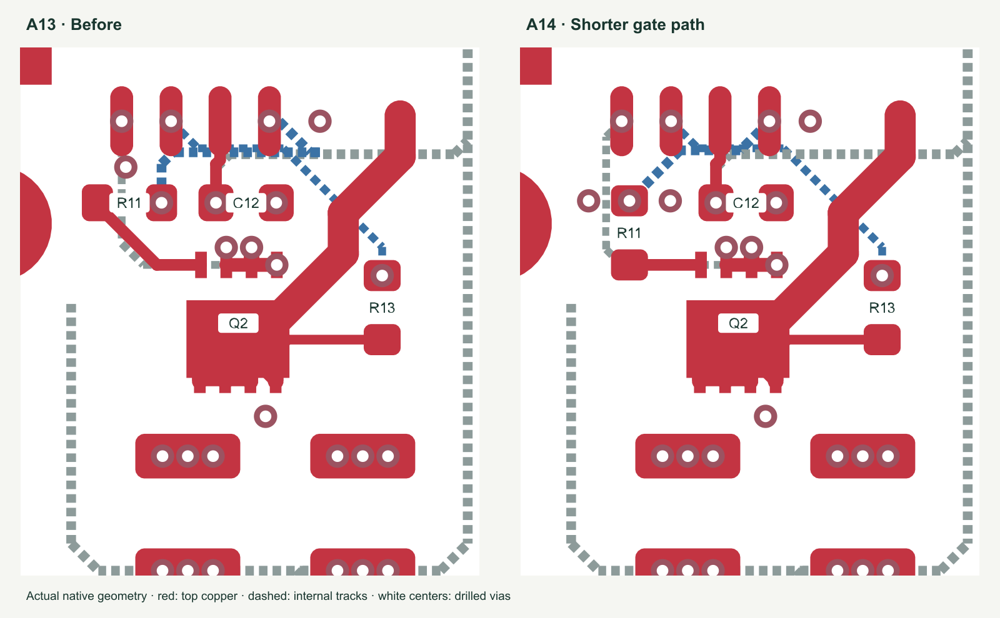
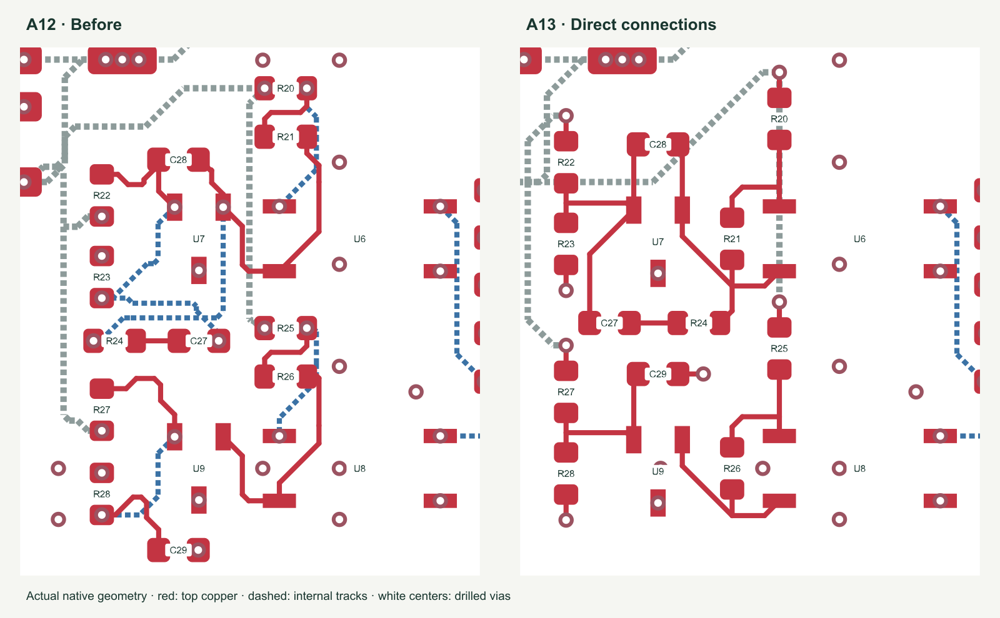

## A14 manufacturing and routing audit

- Reoriented and lowered R11 to face Q2. Its output is a straight 1.840 mm
  connection, down from 3.367 mm. The driver-to-resistor trace drops from
  6.331 to 4.449 mm: combined explicit gate routing is **35% shorter**.
  The dedicated VSS pickup is rerouted around the relocated via; its explicit
  length increases from 7.368 to 8.021 mm while keeping the same source pickup.
- Widened the only 0.16 mm routed control launch to 0.20 mm. All explicit
  routed tracks are now at least 0.20 mm wide. Final pours preserve drive
  references, switching-node exclusions and connector soldering thermals.
- Refreshed all 43 exact electronic codes on 11 October. Every code has
  stock for five fitted boards before order-specific attrition; F1 (28 units)
  and L2 (39 units) have the lowest available quantities.
- Added 16 explicit fabrication/assembly-data screens, including connector
  annuli, BOM/CPL identity, mask clearances and every paste aperture. The
  smallest aperture area ratio is **0.7405** at a 0.125 mm stencil.
- JLC Standard PCBA publishes a 70 × 70 mm handling minimum, rails and
  fiducials. The supplied design remains a single 64 × 56 mm board.
  JLC must accept and provide the handling arrangement.
- Corrected duplicate manufacturing issue IDs and added a file-specific
  handoff. Core fitting, mating-plug delivery and full turnkey are unconfirmed.

[Turnkey readiness and handoff](TURNKEY-READINESS.html) ·
[Actual rectifier routing comparison](evidence/Rectifier-routing-before-after.png) ·
[A14 measurements](evidence/A14-layout-audit.json).

The A14 board contains 497 explicit track segments, 824.950 mm of summed
centerline length and 198 routed vias, including 50 ground stitches.
The six T1 transitions bring the filled/capped-hole requirement to 204.
Electronic identities, values and pin nets are unchanged; the schematic
remains A12. The inherited A13 feedback improvements below remain.

The following A13 results are retained as historical context.

# A13 direct routing and passive assembly review

11 October 2026. Native KiCad PCB revision A13; the A12 electrical schematic,
part values and pin nets are unchanged. KiStack placement and review workflow.

The A12 angle cleanup preserved obsolete waypoints from earlier placements.
It replaced individual slanted segments with more segments without adequately
reconsidering the complete connection. Several resistor orientations also made
their connected pads face away from each other. A13 corrects both problems.

## Placement and connections

- R22/R23 and R27/R28 face their common divider node. Their connections are
  straight vertical links, with the regulator reference branching between pads.
- R20/R25 feed the optocoupler LEDs directly. R21/R26 sit beside their input
  pins, with a straight outward entry at each resistor end. The cathode branches
  occur beyond the resistor land, rather than attaching three tracks to the pad.
- U7/U9, C27–C29 and R24 move with those networks. Seven local feedback nets
  remain entirely on F.Cu, above the same-domain return plane. Their 11 former
  signal vias are removed; aggregate explicit trace length drops from 80.943
  to 49.894 mm, a 38.4% reduction.
- R4/R6 turn to face R5/R7, eliminating the receiver-divider U-shaped links.
  C5/C6 connect directly. R19/C23 turn to simplify the bias ripple network.
- Whole route chains are shortened inside a limited corridor while retaining
  terminals, branch connections, widths and layers. Native copper clearance,
  mounting exclusions, edges and the GD1 return corridor constrain the cleanup.
  Final filled-plane audits independently check the resulting return paths.

The board has 501 explicit route segments versus 797 in A12, 828.205 versus
879.052 mm of summed centerline length, and 197 versus 211 routed vias.
These sums include branches and multiple nets; they are not point-to-point
signal lengths, extracted inductance or measured electrical performance.
The transformer winding artwork is excluded and unchanged.

## Tombstoning and what was applied

Tombstoning results from unequal solder-wetting forces at the two ends of a
passive component. Land geometry, solder volume, placement and reflow conditions
all contribute. Keeping the two lands and paste openings symmetric addresses
one part of the problem. [Murata mounting guidance](https://article.murata.com/en-eu/article/basics-of-capacitors-6)

The copper connected to each land also affects heating and cooling. Different
trace widths, multiple branches at one land, nearby plated holes and direct
plane connections can create unequal thermal loading. Eurocircuits recommends
matched track widths extending at least 0.25 mm beyond the land, and at least
0.25 mm from land edge to via-hole edge. [Eurocircuits assembly guidance](https://www.eurocircuits.com/technical-guidelines/pcb-assembly-guidelines/tombstoning/)

R20–R23 and R25–R28 now use equal copper and paste lands and a single outward
0.20 mm top-layer neck per pad. No via sits in those lands. The native audit
measures at least 0.375 mm of unbranched neck beyond each land and at least
0.45 mm from land edge to a via-hole edge. The divider junctions sit between
the two resistor lands, with 0.375 mm beyond each land before the branch.
Automatic ground stitches now avoid resistor and capacitor lands, including
same-net pads, so later stitching cannot undo these local choices.

This is a targeted geometry improvement, not proof of identical thermal
impedance or tombstone-free assembly. Power bypass and energy-transfer
connections retain their short, wider copper: adding long thin necks to those
parts solely for thermal symmetry would compromise their electrical purpose.
Remaining filled/capped vias, paste printing, placement and reflow still need
supplier process review and first-article validation. A bend angle alone is
not a predictor of tombstoning.

## Checks and manufacturing data

Native ERC, DRC, connectivity and schematic parity pass. Independent checks
cover winding contacts, switching-node voids, adjacent return planes, 19 pours,
49 ground stitches, connector thermals, passive entries and actual silkscreen
stroke clearance. The minimum silk-to-mask gap remains 0.2211 mm.

All 75 purchased components remain on top. CPL, assembly pad map, Gerbers,
drills and renders are regenerated from the current board. The drill map now
specifies 203 filled/capped interconnects: 197 routed vias and six T1 transitions.
Four connector and four mounting holes stay open. Only single-board data are
supplied; JLCPCB defines any factory handling panel.

See [passive geometry](evidence/passive-routing-audit.json),
[path comparison](evidence/A13-layout-audit.json),
[filled pours](evidence/pour-and-stencil-audit.json) and
[the validation record](VALIDATION.md). Hardware remains unbuilt; full turnkey
service and electrical qualification are not confirmed.
